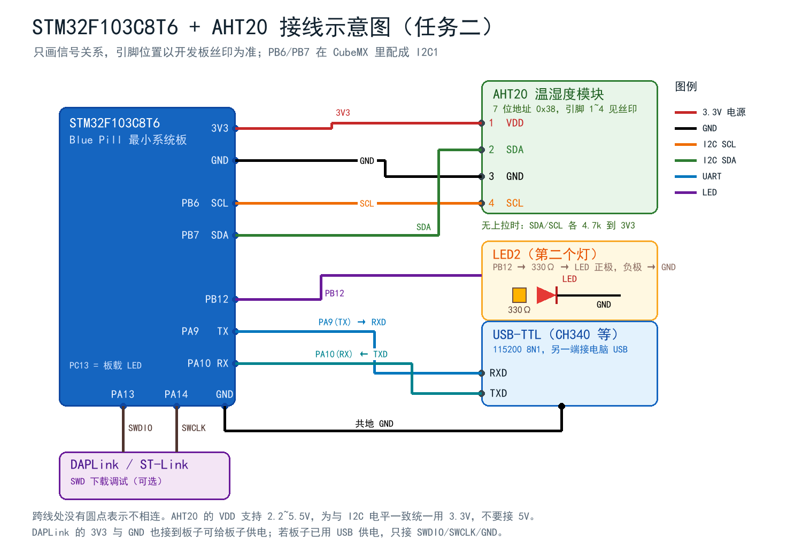

# 任务二完整教程：I2C + AHT20 温湿度采集 + 多任务串口输出

> 目标读者：已经会用 Keil 建工程、点亮过 LED，但还没做过 I2C 传感器和 RTOS 的同学。
> 本文按"照着做就能出数据"的顺序写，每一步都给出**怎么做**和**为什么这么做**。

---

## 0. 先回答那个最关键的问题：不做任务一，怎么"在任务一的基础上"做任务二？

老师的要求是：任务二第 3 小问要把"第 3 个 task 改成每 2 秒采集温湿度"。
这句话隐含一个前提——你得先有"任务 1、任务 2、任务 3"这套多任务框架。

但任务是分两次交的，这次先交任务二。于是有两种做法：

| 做法 | 问题 |
| --- | --- |
| A. 现在就完整移植 uC/OS-III，再做任务二 | 移植内核 + 调 I2C，两个难点叠在一起，一旦不出数据根本分不清是谁的锅 |
| B. 先用裸机 `while(1)` 轮询，等任务一时再全部重写 | 代码结构跟"多任务"完全不搭，任务一来了等于重做，而且没法证明"3 个任务在同时跑" |

本工程走的是第三条路，也是我在实际工程里常用的做法：

> **先把"任务"这个概念抽象出来，写一个 100 行的轻量调度器（OSAL）当"替身"，
> 对外提供的 API 故意和 uC/OS 长得一样：`OSAL_TaskCreate()` / `OSAL_Start()`。
> 三个任务函数体、周期、打印格式，全部按最终 uC/OS 版本写。
> 等任务一移植完内核，只要把 `OSAL_*` 换成 `OSTaskCreate()` / `OSTimeDly()`，
> 任务函数一行都不用改。**

好处很直接：

1. 现在就能演示"3 个任务、3 个周期、互不干扰"，任务二第 3 小问当场就能验收；
2. 任务一来了不用推翻重来，只换"壳"不换"瓤"；
3. 报告里可以理直气壮地写清楚：**这一版用的是过渡调度器，不是 uC/OS**（学术诚实很重要，
   答辩时被问到"你这是 uC/OS 吗"要能答上来）。

具体的对接方法写在 [04_与任务一对接_uCOS-III.md](04_与任务一对接_uCOS-III.md)，本文只管把任务二跑通。

---

## 1. 实验目标与验收标准

做完之后，你应该能拿出下面这些证据：

| 编号 | 验收点 | 怎么证明 |
| --- | --- | --- |
| ① | 串口每 2 s 输出一行温湿度 | 串口助手截图，行首时间戳间隔 ≈ 2000 ms |
| ② | 板载 LED 1 s 翻转一次 | 录像/秒表，或用示波器/逻辑分析仪抓 PC13 |
| ③ | 第二个 LED 3 s 翻转一次 | 同上（抓 PB12） |
| ④ | 三者同时成立、互不干扰 | 两个 LED 各自节拍稳定 + 串口每 2 s 一行不卡顿 |
| ⑤ | 能讲清软件 I2C 与硬件 I2C 的区别 | 见文档 02 |

第 ④ 条是重点。很多人只贴一张"有温湿度输出"的图就交了，其实那只能证明 I2C 通了，
证明不了"多任务"。真正能证明多任务的是**时间戳的交错关系**，本文第 10 节会教你怎么看。

---

## 2. 器材清单

| 器材 | 数量 | 备注 |
| --- | --- | --- |
| STM32F103C8T6 最小系统板（Blue Pill） | 1 | 64 KB Flash / 20 KB RAM |
| AHT20 温湿度模块 | 1 | 7 位地址固定 0x38，4 个引脚 |
| USB-TTL 模块（CH340 / CP2102 / FT232） | 1 | 3.3 V 电平，用于看串口 |
| DAPLink 或 ST-Link | 1 | SWD 下载 |
| 面包板 | 1 | |
| 杜邦线（母对母/公对母） | 若干 | 建议不同颜色：红=3V3，黑=GND |
| 330 Ω 电阻 + 红色 LED | 1 套 | 第二个灯，没有也能做（见 3.4） |
| 万用表 | 1 | 可选，但强烈建议用来确认 3.3V 和通断 |

> **关于供电**：Blue Pill 可以用 USB 供电，也可以用 DAPLink 的 3.3 V 供电。
> 两种都接也行，但**只保留一个 3.3V 源头**更安全（避免两个电源顶牛）。

---

## 3. 接线

### 3.1 接线图



图里只画"信号关系"，实际引脚位置以板子丝印为准（Blue Pill 的 3.3V/GND 有好几个，
随便挑一个都行）。

### 3.2 接线表

**AHT20（4 个脚，编号看模块丝印，别接反）**

| AHT20 引脚 | 名称 | 接到 | 说明 |
| --- | --- | --- | --- |
| 1 | VDD | 3.3V | 手册写 2.2~5.5 V，但为了 I2C 电平和 3.3V 单片机一致，统一用 3.3 V |
| 2 | SDA | PB7 | I2C1_SDA |
| 3 | GND | GND | |
| 4 | SCL | PB6 | I2C1_SCL |

**USB-TTL（看串口用）**

| USB-TTL | 接到 | 说明 |
| --- | --- | --- |
| RXD | PA9 | PA9 是 USART1_TX，**TX 接 RX** |
| TXD | PA10 | PA10 是 USART1_RX，**RX 接 TX** |
| GND | GND | 必须共地！不共地串口必乱码 |
| 3V3 / 5V | 不接 | 板子已经由 USB/DAPLink 供电，不要再接 |

**DAPLink（下载调试）**

| DAPLink | 接到 |
| --- | --- |
| SWDIO | PA13 |
| SWCLK | PA14 |
| 3V3 | 3.3V（可选） |
| GND | GND |

**第二个 LED（可选）**

```
PB12 ──[330Ω]──▶|── GND
                 LED
```

PB12 高电平点亮。**注意 LED 极性**：长脚（正极）朝 PB12，短脚（负极）朝 GND；
接反了就是"怎么都不亮"，而且不会烧（有电阻限流）。

### 3.3 接完先自检（30 秒，能省你两小时）

1. 万用表量 AHT20 的 VDD-GND：应是 3.3 V 左右。**接成 5V 也能工作**，但和 3.3V 的 I/O
   混用会有电平争议，所以统一 3.3 V。
2. 断电，用万用表通断档量：PB6↔SCL、PB7↔SDA 是否导通，有没有和 GND/3V3 短路。
3. 上电，量 SDA、SCL 对 GND 的电压：**空闲时应接近 3.3 V**（被上拉电阻拉高）。
   如果量到 0 V，说明线接错或模块没上拉、总线被拉死。

### 3.4 没有第二个 LED 怎么办

把 `Inc/board_config.h` 改成两个任务都控制 PC13：

```c
#define BOARD_LED2_PORT      GPIOC
#define BOARD_LED2_PIN       GPIO_PIN_13
#define BOARD_LED2_ON_LEVEL  0
```

这样 1 s 和 3 s 两个任务会抢同一个灯，肉眼看到的是"1 s 亮 1 s 灭"里偶尔插一下 3 s 的长亮，
不太好观察。**更推荐**花两毛钱买个 LED，或者用逻辑分析仪同时抓 PC13/PB12 看波形。

---

## 4. 软件准备

| 软件 | 版本 | 作用 |
| --- | --- | --- |
| Keil MDK-ARM | 5.x（本工程用 AC6 编译器 V6.24 验证通过） | 编译、下载、调试 |
| STM32CubeMX | 6.x | 图形化配置外设、生成初始化代码 |
| CH340 驱动 | 随模块提供 | 让电脑认出 USB-TTL |
| 串口助手 | XCOM / SSCOM / PuTTY 任意 | 看串口输出 |

> **重要**：Keil 默认的 AC5 编译器已经不再更新，新装的 MDK 通常只带 **ARMCLANG（AC6）**。
> 本工程是 AC6 工程（`<uAC6>1</uAC6>`），直接打开即可编译，不要用 CubeMX 重新生成
> 一份 AC5 工程覆盖它。

---

## 5. 工程是怎么配出来的（CubeMX 视角）

工程文件是 `01_Project/AHT20_RTOS/AHT20_RTOS.ioc`，打开就能看到以下配置。
如果你想自己从零配一遍，按这张表点：

| 配置项 | 位置（CubeMX） | 值 |
| --- | --- | --- |
| MCU | — | STM32F103C8Tx |
| RCC | System Core → RCC | HSI 8 MHz，PLL 关闭（不依赖外部晶振） |
| SYS | System Core → SYS | Debug: Serial Wire，Timebase: SysTick |
| I2C1 | Connectivity → I2C1 | I2C，Standard/Fast 模式，**400 kHz** |
| I2C1 引脚 | — | PB6=SCL，PB7=SDA（自动分配） |
| USART1 | Connectivity → USART1 | Asynchronous，**115200**，8N1，无流控 |
| USART1 引脚 | — | PA9=TX，PA10=RX |
| PC13 | GPIO | Output Push Pull，初始 High（板载 LED 低电平点亮，High = 灭） |
| PB12 | GPIO | Output Push Pull，初始 Low（外接 LED 高电平点亮，Low = 灭） |
| 工程 | Project Manager | Toolchain: MDK-ARM V5，代码分离 .c/.h |

### 5.1 为什么用 HSI 8 MHz 而不是 72 MHz？

这是本工程和你看到的多数教程**不一样**的地方，需要解释清楚：

- Blue Pill 上的 8 MHz 晶振和两个 22 pF 电容，在便宜板子上**经常有问题**（虚焊、晶振质量差），
  一旦 HSE 起振失败，程序会卡在 `Error_Handler()` 的死循环里，新手根本查不出来。
- HSI 是芯片内部 RC，**永远起得来**，代价是精度 ±1% 左右。
- 本实验对算力没有要求（三个任务加起来一秒钟干不了几微秒活），8 MHz 完全够。
- 串口 115200 在 8 MHz 下的分频误差约 **0.64%**，远小于 UART 能容忍的 ±2~3%，实测不乱码。

如果你就是要 72 MHz（比如后面要跑更重的算法），把 `main.c` 里的 `SystemClock_Config()`
换成 HSE 8 MHz × 9 = 72 MHz 的版本即可，其余代码不用动（因为 `SystemCoreClock` 是
HAL 自动维护的，`HAL_Delay`、波特率计算都会跟着变）。附录 A 给了那份代码。

### 5.2 为什么 I2C 用 400 kHz 而不是 100 kHz

AHT20 一次测量要传 3 字节命令 + 7 字节数据，100 kHz 下总线时间约 1 ms，400 kHz 下约 0.25 ms。
差别不大，但 400 kHz 是 AHT20 明确支持的（手册写最高 400 kHz），用快点没坏处。
**前提是上拉电阻别太大**：4.7 kΩ 在 400 kHz 下上升沿约 1 μs，勉强够；10 kΩ 就偏慢了。

### 5.3 生成的代码和我们手写的代码怎么分工

CubeMX 只负责"外设初始化"，业务逻辑全部手写在不同文件里，这样重新生成代码也不会丢：

```
CubeMX 生成（可以重新生成）    手写（USER CODE 区域 / 独立文件）
─────────────────────────    ─────────────────────────────
main.c 的 HAL_Init/时钟        main.c 里 USER CODE BEGIN 2 的启动流程
gpio.c / i2c.c / usart.c      app_tasks.c / aht20.c / bsp_*.c / osal.c
stm32f1xx_it.c                （不改）
```

---

## 6. 代码是怎么跑起来的

### 6.1 启动流程（`Src/main.c`）

```c
int main(void)
{
  HAL_Init();                  /* 1. HAL 初始化，SysTick 配成 1 ms */
  SystemClock_Config();        /* 2. 时钟：HSI 8 MHz */
  MX_GPIO_Init();              /* 3. PC13 / PB12 */
  MX_I2C1_Init();              /* 4. I2C1 400 kHz */
  MX_USART1_UART_Init();       /* 5. USART1 115200 */

  if (BSP_I2C_Init() == 0U)    /* 6. 选硬件/软件 I2C，做总线恢复 */
  {
    Error_Handler();
  }

  App_TasksInit();             /* 7. 打印横幅、初始化 AHT20、创建 3 个任务 */
  OSAL_Start();                /* 8. 启动调度器，正常情况下不返回 */
  while (1) { }
}
```

顺序不能乱：**串口必须最先能用**，不然前面初始化失败你连错误信息都看不到。

### 6.2 AHT20 驱动（`Src/aht20.c`）

驱动只做三件事，接口刻意做得"很笨"，方便换 I2C 实现：

```c
uint8_t AHT20_Init(void);                                    /* 上电/校准，返回 AHT20_OK */
uint8_t AHT20_StartMeasurement(void);                        /* 触发一次转换 */
uint8_t AHT20_ReadMeasurement(float *t, float *h);           /* 读结果：OK / BUSY / ERROR */
```

**① 初始化**里有两个容易踩的点：

```c
HAL_Delay(100U);                     /* 上电后至少等 40 ms，这里给足 100 ms */

if (BSP_I2C_Read(AHT20_I2C_ADDR7, &status, 1U) == 0U)
{
    return AHT20_ERROR;              /* 没应答：供电/接线/上拉/地址 四个方向查 */
}

if ((status & 0x08U) == 0U)          /* bit3 = CAL，0 表示没校准 */
{
    uint8_t cmd[3] = {0xBE, 0x08, 0x00};
    BSP_I2C_Write(AHT20_I2C_ADDR7, cmd, 3U);
    HAL_Delay(10U);
}
```

"读一次状态"这个动作本身就是**在测试 I2C 通不通**：如果 AHT20 没应答，
`HAL_I2C_Master_Transmit` 会返回 `HAL_ERROR`（NACK），我们就能在串口上看到 `init FAIL`，
而不是等到读数据时才一脸茫然。

**② 触发测量**只有一条命令：

```c
uint8_t cmd[3] = {0xAC, 0x33, 0x00};
BSP_I2C_Write(AHT20_I2C_ADDR7, cmd, 3U);
```

发完之后芯片开始转换，**必须等 80 ms**（手册给的典型值）才能读，早读了 bit7 还是 1。

**③ 读数**：一次读 7 个字节。

```text
buf[0]  状态（bit7=忙, bit3=已校准）
buf[1..3] 湿度 20 bit
buf[3..5] 温度 20 bit（buf[3] 高 4 位是湿度低位，低 4 位是温度高位）
buf[6]  CRC8
```

拼接和换算：

```c
raw_humi = ((uint32_t)buf[1] << 12) | ((uint32_t)buf[2] << 4) | ((uint32_t)buf[3] >> 4);
raw_temp = (((uint32_t)buf[3] & 0x0FU) << 16) | ((uint32_t)buf[4] << 8) | buf[5];

*humidity    = (float)raw_humi * 100.0f / 1048576.0f;          /* 2^20 = 1048576 */
*temperature = (float)raw_temp * 200.0f / 1048576.0f - 50.0f;
```

> 为什么是 2^20？因为 20 bit 满量程对应 100 %RH 和 200 ℃ 的量程宽度（-50~+150）。
> 手册给的公式就是这个，别自己改。

具体算例和数据手册细节见 [03_AHT20数据手册解读.md](03_AHT20数据手册解读.md)。

### 6.3 三个任务（`Src/app_tasks.c`）

任务 1 和任务 2 简单到不能再简单——“翻转一下灯”（串口那行受 `APP_LOG_LED` 控制，
默认关掉，所以平时串口里看不到它）：

```c
static void Task_Led1(void *arg)
{
    (void)arg;
    s_led1_on = (s_led1_on != 0U) ? 0U : 1U;
    Led_Write(BOARD_LED1_PORT, BOARD_LED1_PIN, BOARD_LED1_ON_LEVEL, s_led1_on);
#if (APP_LOG_LED != 0)   /* 默认关：串口只留温湿度 */
    BSP_UART_Printf("[%8lu ms] TASK1  LED1 -> %s\r\n",
                    (unsigned long)HAL_GetTick(), (s_led1_on != 0U) ? "ON " : "OFF");
#endif
}
```

`Led_Write()` 处理了"高电平点亮 / 低电平点亮"两种板子，改板子只改宏：

```c
static void Led_Write(GPIO_TypeDef *port, uint16_t pin, uint8_t active_level, uint8_t on)
{
    GPIO_PinState state;
    if (active_level != 0U) state = (on != 0U) ? GPIO_PIN_SET   : GPIO_PIN_RESET;
    else                    state = (on != 0U) ? GPIO_PIN_RESET : GPIO_PIN_SET;
    HAL_GPIO_WritePin(port, pin, state);
}
```

任务 3 稍微讲究一点，它是一个**状态机**（下一节解释为什么）：

```c
switch (s_state)
{
case AHT_ST_INIT:   /* 上电初始化（失败就 1 s 后重试，不会卡死整个系统） */
case AHT_ST_IDLE:   /* 到 2 s 了 → 发触发命令 → 进 WAIT */
case AHT_ST_WAIT:   /* 等够 80 ms → 读数据 → 打印 → 回 IDLE，下次 2 s 后再来 */
}
```

`App_TasksInit()` 负责开机横幅、初始化 AHT20、创建三个任务：

```c
(void)OSAL_TaskCreate("LED1",  Task_Led1,  0, APP_LED1_PERIOD_MS);   /* 1000 ms */
(void)OSAL_TaskCreate("LED2",  Task_Led2,  0, APP_LED2_PERIOD_MS);   /* 3000 ms */
(void)OSAL_TaskCreate("AHT20", Task_Aht20, 0, APP_AHT20_POLL_MS);    /*   10 ms */
```

注意第三个参数是 **10 ms**，不是 2000 ms。因为任务 3 要"等 80 ms 再读"，
它必须能频繁醒来查看状态；**真正的 2 s 采样周期由状态机内部的时间戳控制**。
这是"任务周期"和"业务周期"分离的典型写法。

### 6.4 为什么任务 3 不能直接 `HAL_Delay(80)`

这是本工程最值得讲的一个设计点，也是"为什么要 RTOS"的活教材。

本工程的 `OSAL` 是**协作式**调度：谁在跑，谁就占着 CPU，除非它自己返回。
如果任务 3 写成：

```c
AHT20_StartMeasurement();
HAL_Delay(80);                    /* ← 卡在这里 80 ms，谁也跑不了 */
AHT20_ReadMeasurement(&t, &h);
```

后果是：

- 任务 1 的 1 s 周期变成 1.08 s，任务 2 变成 3.08 s（每次都多等 80 ms）；
- LED 的闪烁节拍被拖慢，1 s 变 1.08 s，越跑越偏；
- 如果哪天采样改成 500 ms 一次，抖动会更明显。

而状态机版本在"等 80 ms"这段时间里**主动返回**，调度器可以愉快地去跑 LED 任务，
CPU 还能顺便 `__WFI()` 睡一觉。**这就是抢占式内核存在的意义**——
在真正的 uC/OS 里，你可以放心地写 `HAL_Delay(80)` 或者 `OSTimeDly()`，
因为内核会在你等待时自动切换到别的任务。所以：

> 裸机/协作式：**不许阻塞**，必须自己拆状态机。
> RTOS：**可以阻塞**，把"等待"交给内核。
>
> 同一段业务，两种写法，这就是任务一要求"移植 uC/OS"的真正价值。

到任务一的时候，任务 3 就可以简化成 5 行（见文档 04）。

### 6.5 串口打印为什么不用 `printf`

新手最容易踩的坑：在 Keil 里 `#include <stdio.h>` 然后直接 `printf`，结果程序一运行就
HardFault 或者卡死。原因是 ARM 的 `printf` 默认走 **semihosting**（半主机），
它会去等调试器响应，而你单独上电运行时根本没有调试器。

本工程的做法是自己拼字符串：

```c
void BSP_UART_Printf(const char *fmt, ...)
{
    char    buf[160];
    va_list ap;

    va_start(ap, fmt);
    n = vsnprintf(buf, sizeof(buf), fmt, ap);   /* 只格式化，不输出 */
    va_end(ap);

    HAL_UART_Transmit(&huart1, (uint8_t *)buf, (uint16_t)n, 100U);   /* 自己发 */
}
```

好处：

1. 不依赖 semihosting，脱机运行完全正常；
2. 不用开 `microlib`（开了以后和后面加 uC/OS 可能有冲突）；
3. 缓冲区固定 160 字节，不会动态分配内存，对 RTOS 友好；
4. 打印是**同步阻塞**的，一行 60 字节在 115200 下约 5.2 ms —— 这个时间
   在 10 ms 的任务周期里可以接受；如果以后要发大量数据，记得改成 DMA + 环形缓冲。

---

## 7. 编译

### 7.1 在 Keil 里编译

1. 双击 `01_Project/AHT20_RTOS/MDK-ARM/AHT20_RTOS.uvprojx`；
2. `Project → Build Target`（F7）；
3. 看 Build Output 窗口：

```text
Program Size: Code=17934 RO-data=1298 RW-data=16 ZI-data=2008
"AHT20_RTOS\AHT20_RTOS.axf" - 0 Error(s), 0 Warning(s).
```

`Code + RO-data` ≈ 19.0 KB（占 64 KB Flash 的 30%），`RW + ZI` ≈ 2.0 KB（占 20 KB RAM 的 10%）。

### 7.2 命令行编译（不想开 IDE 时）

```bat
"D:\keil\UV4\UV4.exe" -b "D:\...\MDK-ARM\AHT20_RTOS.uvprojx" -j0 -o "D:\...\MDK-ARM\build.log"
```

`-b` 是 build，`-j0` 不弹窗，`-o` 输出日志。**路径必须写绝对路径**，否则日志不会生成。
返回值 0/1 表示成功/失败。

---

## 8. 下载

1. `Options for Target → Debug` → 选 `CMSIS-DAP Debugger`（用 DAPLink）或 `ST-Link Debugger`；
2. 点旁边的 `Settings`，在 `Debug` 页确认能识别到芯片（`SW Device` 里出现 `0x1BA01477` 之类）；
3. 切到 `Flash Download` 页，勾 `Reset and Run`，Programming Algorithm 选
   `STM32F10x Med-density Flash`（64 KB）；
4. `Flash → Download`（F8）。

下载成功会提示 `Application running ...`，此时板子上的 LED 应该已经开始闪。

> 如果提示 `No target connected`：先检查 DAPLink 的 3V3/GND 有没有接、SWDIO/SWCLK 有没有接反、
> 板子有没有供电。Blue Pill 上 SWD 是 PA13/PA14 那两个靠里的针。

---

## 9. 上位机验证

### 9.1 串口助手设置

| 项 | 值 |
| --- | --- |
| 端口 | 设备管理器里 `USB-SERIAL CH340 (COMx)` |
| 波特率 | 115200 |
| 数据位/停止位/校验 | 8 / 1 / None |
| 流控 | 无 |
| **编码** | **UTF-8**（否则中文是乱码） |

### 9.2 你应该看到什么

```text
==================================================
  STM32F103C8T6 + AHT20  RTOS 多任务实验
  姓名: 你的名字   学号: 你的学号
  CPU : 8 MHz (HSI)
  TASK1: LED1 每 1000 ms 翻转一次
  TASK2: LED2 每 3000 ms 翻转一次
  TASK3: AHT20 每 2000 ms 采集一次
  I2C  : 硬件外设 I2C1 @ PB6/PB7, AHT20 addr 0x38
==================================================
[     112 ms] BOOT   AHT20 init OK
[     112 ms] OSAL   3 tasks created, starting...
T=26.50 C  H=55.95 %RH
T=26.52 C  H=56.03 %RH
T=26.55 C  H=56.10 %RH
...
```

### 9.3 怎么证明“多任务是同时在跑”

默认串口只输出温湿度、不报 LED 状态，所以证据分两路：

1. **看灯**（最直接）：PC13 亮 1 s / 灭 1 s，PB12 亮 3 s / 灭 3 s，两个节拍同时成立。
   TASK3 每次采集要占 80 ms，如果调度没生效，灯会被肉眼可见地拖成 1.08 s / 3.08 s。
2. **看串口间隔**：TASK3 每 2 s 一行，用串口助手的“时间戳”功能核对，始终在 2000 ms 上下几毫秒。

想把三个时间基准都变成数字？把 `Inc/board_config.h` 的 `APP_LOG_LED` 改成 `1` 重新编译，
串口就会多出 TASK1/TASK2 的翻转行，此时可以看到这样的交错：

| 时间 | 事件 | 说明 |
| --- | --- | --- |
| 113 | TASK1 ON | |
| 113 | TASK2 ON | |
| 193 | TASK3 数据 | 触发在 113，等了 80 ms |
| 1113 | TASK1 OFF | 距上次 **1000 ms** |
| 2113 | TASK1 ON | 距上次 **1000 ms** |
| 2193 | TASK3 数据 | 距上次 **2000 ms** |
| 3113 | TASK2 OFF | 距上次 **3000 ms** |
| 3113 | TASK1 OFF | 和 TASK2 撞在同一毫秒，正是"独立周期"的体现 |

关键点：**TASK3 每次采样要占用 80 ms 的等待时间，但 TASK1 的间隔始终是 1000 ms、
TASK2 始终是 3000 ms**（打开 `APP_LOG_LED` 后能直接量出来）。如果写成 `HAL_Delay` 版本，
这里会变成 1080/3080。答辩时把这张表一贴，比说一百句都管用。

---

## 10. 用秒表/录像做交叉验证

串口时间戳是软件给的，严格的老师会问"你怎么证明这不是你自己编的"。
交叉验证三件套：

1. **手机录像 30 秒**，数 PC13 闪了多少次 —— 30 s 内应该亮灭各 15 次；
2. **PB12 同时录像** —— 30 s 内亮灭各 5 次；
3. **把日志和录像对齐**：把 `APP_LOG_LED` 改成 `1` 重烧，录像里 PB12 变亮的瞬间，
   日志里应该正好有一行 `TASK2  LED2 -> ON`，对得上就说明时间戳不是编的。

想更专业就上逻辑分析仪（十几块钱的 24 MHz 那种就够）：抓 PC13、PB12 和 PA9（TX），
一眼就能看到三个时间基准是独立的。

---

## 11. 排错手册

按"从下往上"的顺序查，别一上来就怀疑代码。

### 11.1 编译类

| 现象 | 原因 | 解决 |
| --- | --- | --- |
| `unknown type name 'UART_HandleTypeDef'` | `stm32f1xx_hal_conf.h` 里没打开 UART 模块 | 取消 `HAL_UART_MODULE_ENABLED` 的注释 |
| `cannot open source input file "xxx.h"` | Include 路径没加 | `Options → C/C++ → Include Paths` 加上 `../Inc` 等 |
| `L6218E: Undefined symbol HAL_UART_Init` | 没把 `stm32f1xx_hal_uart.c` 加进工程 | 加进 `Drivers/STM32F1xx_HAL_Driver` 组 |
| `#error "Please select first the target STM32F1xx device"` | 宏没定义 | `Options → C/C++ → Define` 填 `USE_HAL_DRIVER,STM32F103xB` |
| 一堆 `A1586E` / `armcc not found` | 用了 AC5 工程但机器只有 AC6 | 用本工程（AC6），或装 AC5 并切回 |

### 11.2 下载类

| 现象 | 原因 | 解决 |
| --- | --- | --- |
| `No target connected` | 接线/供电/驱动 | 查 SWDIO/SWCLK/GND/3V3；DAPLink 灯是否亮 |
| `Cannot access target` | 芯片被读保护 / 程序把 SWD 关了 | 按住复位再点下载；或用 ST-Link Utility 解除保护 |
| 下载成功但没反应 | 没勾 `Reset and Run`，或程序卡在 `Error_Handler` | 勾上 Reset and Run；接串口看有没有输出 |

### 11.3 串口类

| 现象 | 排查顺序 |
| --- | --- |
| 完全没输出 | ① PA9/PA10 有没有接反 ② 有没有共地 ③ 波特率对不对 ④ 程序是不是卡在 AHT20 初始化 |
| 有输出但全是乱码 | ① 波特率 ② **编码没选 UTF-8**（中文乱码但数字正常，就是编码问题）③ 时钟不是 8 MHz（改过时钟没改波特率） |
| 输出一行就停 | 多半进了 HardFault，见 11.5 |
| 中文变问号 | 串口助手编码不是 UTF-8；或源文件不是 UTF-8 保存 |

### 11.4 I2C 类（最常见）

串口上出现：

```text
[     112 ms] BOOT   AHT20 init FAIL, task3 will retry
[    1112 ms] TASK3  AHT20 init FAIL (err=1)
```

说明 AHT20 没有应答（NACK）。按这个顺序查：

1. **供电**：万用表量模块 VDD-GND 是否 3.3 V。模块灯（如果有）亮不亮。
2. **接线**：SCL→PB6、SDA→PB7，**别接反**（AHT20 的 2 脚是 SDA、4 脚是 SCL，和很多模块不一样！）。
3. **上拉**：断电量 SDA/SCL 对 3.3V 的电阻，应为 4.7 kΩ 左右。没有上拉 → 总线永远是低电平 → 必然 NACK。
4. **地址**：AHT20 固定 0x38（7 位），代码里 `AHT20_I2C_ADDR7` 就是 0x38，HAL 会自动左移成 0x70。
   **不要**自己写成 0x70。
5. **线太长/杜邦线接触不良**：I2C 是开漏 + 上拉，线长了上升沿变缓。先用 10 cm 短线验证。
6. **模块是 5V 供电、I2C 上拉到 5V**：这时 PB6/PB7 会被 5V 拉高，STM32 的 I/O 虽然 5V 容忍，
   但 SDA 作为双向线可能出问题。统一改 3.3V。

如果 `init OK` 但读数据报 `read FAIL`，多半是读的时机太早（80 ms 没到）或者总线被干扰，
把 `AHT20_MEASURE_MS` 从 80 改到 100 试试。

### 11.5 HardFault 类

现象：串口打印到一半突然没了，LED 也不闪了。

定位方法：

1. 在 `HardFault_Handler` 里加死循环断点，看调用栈（Keil 的 Call Stack 窗口）；
2. 常见原因：
   - 用了 `printf` 没重定向（semihosting）→ 改用 `BSP_UART_Printf`；
   - 栈太小，`vsnprintf` 递归/大局部数组爆栈 → 本工程 `StackSize=0x400`，够用；
   - 数组越界（比如 `buf[7]` 读了 8 个字节）；
   - 中断里调用了阻塞函数。
3. 打开 `Options → Target → Use MicroLIB` **不是**解决办法，反而可能引入新问题。

### 11.6 周期不准类

| 现象 | 原因 |
| --- | --- |
| LED 闪得比 1 s 快/慢一倍 | 系统时钟不是你以为的那个（改了时钟没改 `SystemCoreClock`） |
| 任务 1 间隔 1080 ms | 任务里用了 `HAL_Delay`（阻塞）→ 改成状态机 |
| 串口打印间隔忽长忽短 | 打印本身耗时 + 中断被关太久；检查有没有长临界区 |
| 上电第一次采样特别慢 | `AHT20_Init()` 里有 100 ms 上电延时，正常 |

---

## 12. 实验记录表（可直接抄进报告）

| 项目 | 记录 |
| --- | --- |
| 开发板 | STM32F103C8T6（Blue Pill），HSI 8 MHz |
| 传感器 | AHT20，I2C 地址 0x38，I2C1 400 kHz（PB6/PB7） |
| 串口 | USART1，115200 8N1（PA9/PA10） |
| 编译结果 | 0 Error / 0 Warning，Code 17934 B，RAM 2024 B |
| 室温实测 | T = ____ ℃，H = ____ %RH |
| 与温度计对比 | 偏差 ____ ℃ |
| 任务 1 周期 | 实测 ____ ms（标称 1000 ms） |
| 任务 2 周期 | 实测 ____ ms（标称 3000 ms） |
| 任务 3 周期 | 实测 ____ ms（标称 2000 ms） |
| 连续运行 30 min | 有无死机/丢数据：____ |

---

## 附录 A：72 MHz（HSE 8 MHz × 9）时钟配置

如果坚持要用外部晶振，把 `main.c` 的 `SystemClock_Config()` 换成：

```c
void SystemClock_Config(void)
{
  RCC_OscInitTypeDef RCC_OscInitStruct = {0};
  RCC_ClkInitTypeDef RCC_ClkInitStruct = {0};

  RCC_OscInitStruct.OscillatorType      = RCC_OSCILLATORTYPE_HSE;
  RCC_OscInitStruct.HSEState            = RCC_HSE_ON;
  RCC_OscInitStruct.HSEPredivValue      = RCC_HSE_PREDIV_DIV1;
  RCC_OscInitStruct.HSIState            = RCC_HSI_ON;
  RCC_OscInitStruct.PLL.PLLState        = RCC_PLL_ON;
  RCC_OscInitStruct.PLL.PLLSource       = RCC_PLLSOURCE_HSE;
  RCC_OscInitStruct.PLL.PLLMUL          = RCC_PLL_MUL9;      /* 8 MHz × 9 = 72 MHz */
  if (HAL_RCC_OscConfig(&RCC_OscInitStruct) != HAL_OK) { Error_Handler(); }

  RCC_ClkInitStruct.ClockType      = RCC_CLOCKTYPE_HCLK | RCC_CLOCKTYPE_SYSCLK
                                   | RCC_CLOCKTYPE_PCLK1 | RCC_CLOCKTYPE_PCLK2;
  RCC_ClkInitStruct.SYSCLKSource   = RCC_SYSCLKSOURCE_PLLCLK;
  RCC_ClkInitStruct.AHBCLKDivider  = RCC_SYSCLK_DIV1;
  RCC_ClkInitStruct.APB1CLKDivider = RCC_HCLK_DIV2;          /* 36 MHz，I2C 挂在 APB1 */
  RCC_ClkInitStruct.APB2CLKDivider = RCC_HCLK_DIV1;          /* 72 MHz */
  if (HAL_RCC_ClockConfig(&RCC_ClkInitStruct, FLASH_LATENCY_2) != HAL_OK) { Error_Handler(); }
}
```

注意两点：`FLASH_LATENCY_2`（72 MHz 必须 2 个等待周期），`APB1 = 36 MHz`（不能超过 36 MHz）。
换完之后 `HAL_Delay`、串口波特率、I2C 速率都会自动跟着变，任务代码不用动。

## 附录 B：逻辑分析仪抓什么

| 通道 | 接哪里 | 看什么 |
| --- | --- | --- |
| CH0 | PC13 | 1 s 方波 |
| CH1 | PB12 | 3 s 方波 |
| CH2 | PA9（TX） | 每 2 s 一串数据，约 5 ms 宽 |
| CH3 | PB6（SCL） | 采样瞬间有一串 400 kHz 时钟 |

把四个通道放一起截图，就是"三个任务并行"最硬的证据。
