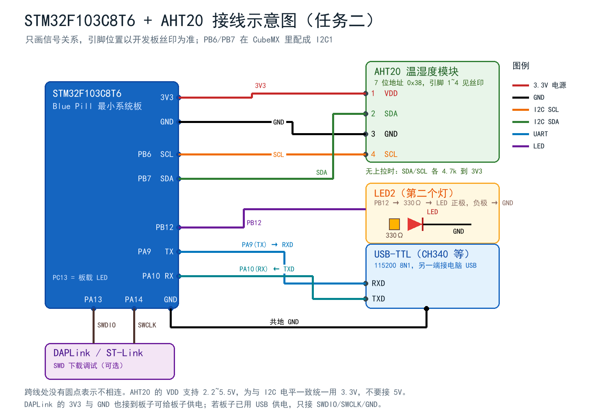

# 【STM32F103】不先移植 uC/OS，也能完成"基于 I2C 的 AHT20 温湿度采集 + 多任务"（HAL + Keil，附完整代码与踩坑）

> 写在前面：这是一份可以直接跟着做的实验记录。全文代码均已在本机
> **Keil MDK 5.43a + ARMCLANG V6.24 + STM32CubeMX** 下编译通过（`0 Error, 0 Warning`），
> 并给出了可复现的串口验证方法。文中所有"坑"都是真实踩到的，报错原文照抄。

---

## 0. 需求拆解：为什么"不做任务一"也能"在任务一基础上"做任务二

课程给了两个任务：

- **任务一**：把 uC/OS-III 移植到 STM32F103，建 3 个任务（1 s 闪灯、3 s 闪灯、2 s 串口打印）；
- **任务二**：I2C 读 AHT20 温湿度，串口输出。其中第 3 小问要求
  **"在任务一多任务程序的基础上，把第 3 个 task 改成每 2 秒采集温湿度并串口输出"**。

问题来了：任务是第 3 小问，前置条件是任务一，但我想先交任务二。怎么办？

**答案：把"多任务"这件事先用自己的极简调度器实现，但把 API 写成 uC/OS 的样子。**

- 写一个 108 行的 `osal.c`（OS Abstraction Layer，任务抽象层），提供
  `OSAL_TaskCreate()` / `OSAL_Start()` / `OSAL_Now()`；
- 三个任务的任务体、周期、打印格式**和最终 uC/OS 版本一字不差**；
- 等以后移植完 uC/OS-III，只把 `OSAL_TaskCreate` 换成 `OSTaskCreate`、
  "任务返回"换成 `OSTimeDlyHMSM`，**应用层代码一行不改**。

这样：
1. 今天就能演示"两个灯不同频率闪 + 每 2 s 串口出温湿度"，即任务二的完整效果；
2. 代码结构上确实"已经有多任务"（3 个任务、3 个周期、互不阻塞）；
3. 将来接 uC/OS 时，改动集中在两个文件里，工作量不到半小时。

> ⚠️ 诚实说明：`osal.c` **不是** uC/OS，它没有抢占、没有独立栈、没有内核对象。
> 它是"任务框架"。写报告时请如实描述，不要写成"已移植 uC/OS"。

---

## 1. 硬件清单与接线

### 1.1 器材

| 器材 | 数量 | 备注 |
| --- | --- | --- |
| STM32F103C8T6 最小系统板（Blue Pill） | 1 | 本次用板载 PC13 LED 作 LED1 |
| AHT20 温湿度模块 | 1 | 7 位地址 0x38 |
| USB-TTL 模块（CH340/CP2102） | 1 | 看串口输出 |
| DAPLink / ST-Link | 1 | 下载调试 |
| 面包板 + 杜邦线 | 1 套 | |
| LED + 330 Ω 电阻 | 1 套 | 第二颗灯（PB12） |
| 万用表 | 1 | 上电前量通断，强烈建议 |

### 1.2 接线表

| STM32F103 | 接到 | 说明 |
| --- | --- | --- |
| 3.3V | AHT20 VDD（引脚 1） | **不要接 5V**，和 I2C 电平保持一致 |
| GND | AHT20 GND（引脚 3） | 必须共地 |
| PB6 | AHT20 SCL（引脚 4） | I2C1_SCL |
| PB7 | AHT20 SDA（引脚 2） | I2C1_SDA |
| PA9 (TX) | USB-TTL RXD | 交叉接 |
| PA10 (RX) | USB-TTL TXD | 交叉接 |
| GND | USB-TTL GND | 共地 |
| PB12 | 330 Ω → LED 正极，LED 负极 → GND | 第二个灯 |
| PA13 | DAPLink SWDIO | 下载 |
| PA14 | DAPLink SWCLK | 下载 |
| GND | DAPLink GND | 下载 |



### 1.3 接线自检（三分钟，能省两小时）

1. **万用表蜂鸣档**：3.3V 与 GND 之间**不能**通（通了就是短路，别上电）；
2. 量 AHT20 的 VDD-GND 之间电压，应该是 3.3 V；
3. 上电后量 SDA、SCL 对 GND 的电压：**空闲时应约等于 3.3 V**（上拉把线拉高）。
   如果只有 0.1~0.5 V，说明没上拉或者线接反了，I2C 一定不通；
4. AHT20 模块正面有个**透气孔，不要用手按住**，否则湿度读数会卡住不动。

> 关于上拉：AHT20 模块板载通常已经带了 4.7 kΩ 上拉。如果你用的是裸芯片或者模块没带，
> 必须在 SDA/SCL 各接一个 4.7 kΩ 到 3.3 V。

---

## 2. CubeMX 配置（关键几项）

| 项目 | 配置 |
| --- | --- |
| MCU | STM32F103C8Tx |
| RCC | HSE/LSE 都选 Disable（用内部 HSI 8 MHz） |
| SYS Debug | Serial Wire（否则下载一次就锁死 SWD） |
| I2C1 | I2C，Speed Mode = Fast Mode，400 kHz |
| USART1 | Asynchronous，115200，8N1 |
| GPIO PC13 | Output Push Pull，初始 High（板载 LED 低电平点亮） |
| GPIO PB12 | Output Push Pull，初始 Low（外接 LED 高电平点亮） |
| 时钟树 | SYSCLK = 8 MHz（HSI），APB1/APB2 都不分频 |
| Toolchain | MDK-ARM，**不要勾 "Generate peripheral initialization as pair of .c/.h"**（保持 CubeMX 默认即可） |

**为什么用 8 MHz 而不是 72 MHz？**

- 72 MHz 要外接 8 MHz 晶振，Blue Pill 上的晶振虚焊/假焊非常常见，一上电就卡在
  `HAL_RCC_OscConfig` 里等 HSE 就绪，表现为"程序不跑"；
- 8 MHz HSI 是芯片内部 RC，一定有；UART 115200 的误差约 0.64%，串口助手完全能正常收；
- AHT20 只跑 400 kHz I2C，8 MHz 主频绰绰有余。

> 如果你确实要 72 MHz，附录给了改法（HSE × 9、FLASH_LATENCY_2、APB1 二分频）。

---

## 3. I2C 原理速览（答辩必问）

### 3.1 两根线，开漏，线与

- SCL（时钟）、SDA（数据），**都是开漏输出 + 外部上拉**；
- 开漏意味着"只能拉低，不能主动拉高"，高电平靠上拉电阻；
- 于是多个设备可以同时挂在总线上：**任何一个拉低，总线就是低**（线与）；
- 由此带来 **ACK**（从机拉低 SDA 应答）和 **仲裁**（多主机同时发，谁拉低谁赢）。

### 3.2 一次传输的骨架

```text
START（SCL 高时 SDA 下降）
  → 地址字节（7 位地址 << 1 | R/W）
  → ACK
  → 数据字节 × N，每字节后跟 1 位 ACK
  → STOP（SCL 高时 SDA 上升）
```

AHT20 的完整读流程：

```text
START → 0x70(W) → 0xAC → 0x33 → 0x00 → STOP     （触发测量）
                ↓ 等 80 ms
START → 0x71(R) → 7 字节 → STOP                  （读结果）
```

### 3.3 软件 I2C 与硬件 I2C 的区别

| 维度 | 软件 I2C（bit-banging） | 硬件 I2C（外设） |
| --- | --- | --- |
| 实现 | 两个普通 GPIO 手动翻转电平 | 芯片内部 I2C 状态机 |
| 引脚 | 任意 GPIO | 固定（PB6/PB7） |
| CPU 占用 | 高（全程忙等） | 低（可配 DMA） |
| 速率 | 一般 ≤ 200 kHz，不准 | 100/400 kHz，精确 |
| 代码量 | 大 | 小（HAL 两行） |
| 出错恢复 | 容易 | 需 DeInit/Init + 9 时钟恢复 |
| 学习价值 | 极高 | 一般 |

**什么时候用软件 I2C？** 引脚被占、需要多路复用、STM32F1 硬件 I2C 踩坑（F1 的 I2C 外设
"BUSY 卡死"是出了名的），或者纯粹为了学协议。

本项目**两份实现都写了**，靠一个宏切换：

```c
#define APP_I2C_USE_SOFT   0   /* 0 = 硬件 I2C1，1 = 软件 I2C */
```

驱动层完全不感知，只调 `BSP_I2C_Init/Write/Read` 三个函数。

---

## 4. AHT20 驱动：三个知识点

### 4.1 上电要"校准"

上电等 100 ms → 读状态字节 → 如果 `bit3 (CAL) == 0`，发 `0xBE 0x08 0x00` 使能校准 →
再读状态确认 CAL=1（最多重试 5 次）。跳过这一步，有些模块会一直返回 0。

### 4.2 触发后必须等 80 ms

发 `0xAC 0x33 0x00` 触发转换，**等 80 ms** 再读。提前读的话状态字节 `bit7 (BUSY)=1`，
数据无效。

### 4.3 20 bit 数据怎么拼

```c
raw_humi = ((uint32_t)buf[1] << 12) | ((uint32_t)buf[2] << 4) | ((uint32_t)buf[3] >> 4);
raw_temp = (((uint32_t)buf[3] & 0x0F) << 16) | ((uint32_t)buf[4] << 8) | (uint32_t)buf[5];

humidity    = raw_humi / 1048576.0f * 100.0f;      /* 2^20 = 1048576 */
temperature = raw_temp / 1048576.0f * 200.0f - 50.0f;
```

`buf[3]` 是**湿度低 4 位 + 温度高 4 位**共用的，这是最容易写错的一行。
`buf[6]` 是 CRC8（poly 0x31，init 0xFF），校验前 6 字节。

算例（可以拿去验算）：

```text
帧：1C 8F 3B 66 1E B8 6D
raw_humi = 0x8F3B6 = 586678 → 55.95 %RH
raw_temp = 0x61EB8 = 401080 → 26.50 ℃
CRC8(1C 8F 3B 66 1E B8) = 0x6D ✓
```

---

## 5. 多任务框架：108 行的"任务壳"

### 5.1 为什么需要它

如果三个任务都写在一个 `while(1)` 里，AHT20 那 80 ms 的等待就会拖慢 LED 的闪烁节奏。
`osal.c` 用"固定节拍 + 轮转"解决这个问题：

```c
void OSAL_Start(void)
{
    OSAL_Init();
    for (;;) {
        uint32_t now = HAL_GetTick();
        uint8_t  ran = 0;

        for (uint8_t i = 0; i < s_task_count; i++) {
            OSAL_Task *t = &s_tasks[i];
            if ((int32_t)(now - t->last_ms) >= 0) {   /* 到点了 */
                t->last_ms += t->period_ms;           /* 固定节拍，不累积漂移 */
                t->fn(t->arg);                        /* 跑一次，必须尽快返回 */
                t->runs++;
                ran = 1;
            }
        }
        if (!ran) { __WFI(); }                        /* 没事干就睡 */
    }
}
```

两个细节：

1. **`last_ms += period_ms` 而不是 `last_ms = now`**：前者不会累积漂移，
   跑一小时误差还是 0；后者每次都会把"执行时间"算进周期里，越跑越慢；
2. **`__WFI()`**：没任务可跑时进低功耗，等中断唤醒，比空转省电。

### 5.2 三个任务

```c
/* LED1：1 s 翻转 PC13 */
static void Task_Led1(void *arg)
{
    static uint8_t on = 0;
    on = !on;
    Led_Write(BOARD_LED1_PORT, BOARD_LED1_PIN, BOARD_LED1_ON_LEVEL, on);
#if (APP_LOG_LED != 0)   /* 默认关：串口只留温湿度 */
    BSP_UART_Printf("[%8lu ms] TASK1  LED1 -> %s\r\n", (unsigned long)OSAL_Now(), on ? "ON" : "OFF");
#endif
}

/* LED2：3 s 翻转 PB12 */
static void Task_Led2(void *arg)
{
    static uint8_t on = 0;
    on = !on;
    Led_Write(BOARD_LED2_PORT, BOARD_LED2_PIN, BOARD_LED2_ON_LEVEL, on);
}

/* TASK3：状态机，10 ms 轮询，内部 2 s 采样一次 */
static void Task_Aht20(void *arg)
{
    static uint8_t  st = AHT_ST_INIT;
    static uint32_t wait_start = 0, wait_ms = 0, next_ms = 0;
    uint32_t now = OSAL_Now();
    float t, h;

    switch (st) {
    case AHT_ST_INIT:
        if (AHT20_Init() == AHT20_OK) { st = AHT_ST_IDLE; next_ms = now; }
        else                          { next_ms = now + 1000; }   /* 1 s 后重试 */
        break;

    case AHT_ST_IDLE:
        if ((int32_t)(now - next_ms) >= 0) {
            if (AHT20_StartMeasurement() == AHT20_OK) {
                wait_start = now; wait_ms = AHT20_MEASURE_MS; st = AHT_ST_WAIT;
            } else {
                next_ms = now + 1000;
            }
        }
        break;

    case AHT_ST_WAIT:
        if ((now - wait_start) >= wait_ms) {
            if (AHT20_ReadMeasurement(&t, &h) == AHT20_OK) {
                /* 打印 */
                next_ms = now + APP_AHT20_PERIOD_MS;
                st = AHT_ST_IDLE;
            } else {
                wait_ms += 10;        /* 还 BUSY？再等 10 ms */
            }
        }
        break;
    }
}
```

### 5.3 为什么不能在这里写 `HAL_Delay(80)`

因为我们这个调度器是**协作式**的：任务必须尽快返回，主循环才能轮到别的任务。
如果在 Task_Aht20 里 `HAL_Delay(80)`：

- CPU 在这 80 ms 里什么都不干；
- 如果此时 LED1 的 1 s 到点了，它得**等这 80 ms 结束才能翻转**；
- 结果是 LED1 的实际周期在 1000 ms 和 1080 ms 之间抖动，LED2 同理变成 3.08 s。

这就是**裸机 + 阻塞延时的通病**。而真正的 RTOS 里，`OSTimeDly(80)` 会把任务挂起、
立刻切到 LED 任务，1 s 的节拍一点不受影响 —— **这就是"为什么要用 RTOS"最直观的例子**，
建议把这段写进报告的"心得体会"。

### 5.4 为什么不直接 `printf`

AC6 的 `printf` 默认走 **semihosting**（半主机），在没有调试器连接时，
`printf` 会卡死在 `BKPT` 指令里，整个程序停在原地。
本工程改用：

```c
void BSP_UART_Printf(const char *fmt, ...)
{
    char buf[160];
    va_list ap;
    va_start(ap, fmt);
    int n = vsnprintf(buf, sizeof(buf), fmt, ap);
    va_end(ap);
    if (n > 0) {
        uint16_t len = (n < (int)sizeof(buf)) ? (uint16_t)n : (uint16_t)sizeof(buf) - 1;
        HAL_UART_Transmit(&huart1, (uint8_t *)buf, len, 100U);
    }
}
```

不开 microlib（将来加 uC/OS 更稳），用 `vsnprintf` 自己也完全够用。

---

## 6. 编译与下载

### 6.1 Keil 编译

打开 `MDK-ARM/AHT20_RTOS.uvprojx`（AC6 工程），F7 编译，应该看到：

```text
Build started: Project: AHT20_RTOS
*** Using Compiler 'V6.24', folder: 'D:\keil\ARM\ARMCLANG\Bin'
...
Program Size: Code=17934 RO-data=1298 RW-data=16 ZI-data=2008
".\AHT20_RTOS\AHT20_RTOS.axf" - 0 Error(s), 0 Warning(s).
```

Flash 占用约 18.8 KB / 64 KB，RAM 约 2 KB / 20 KB，很宽松。

### 6.2 命令行编译（不想开 IDE 时）

```bat
"D:\keil\UV4\UV4.exe" -b "D:\dsh_list\STM32F103_RTOS_AHT20\01_Project\AHT20_RTOS\MDK-ARM\AHT20_RTOS.uvprojx" -j0 -o "D:\dsh_list\build.log"
```

注意 `-b` 后面**必须用绝对路径**，否则 `-o` 的日志文件不会生成。

### 6.3 下载

Keil → Options for Target → Debug → 选 **CMSIS-DAP Debugger** → Settings 能看到 SWD 芯片：

- Port: SW
- Max Clock: 1 MHz（线长就降速）
- Flash Download → 勾 **Reset and Run**

然后 F8 下载。如果提示 `No target connected`：检查 DAPLink 的 3.3V/GND/SWDIO/SWCLK 四根线，
以及 `SYS Debug` 是否配成了 Serial Wire（配成 JTAG 时 SWD 会被关掉）。

---

## 7. 串口助手验证

1. 打开 XCOM / SSCOM / PuTTY，选 CH340 的 COM 口；
2. **波特率 115200、8 数据位、1 停止位、无校验、无流控**；
3. **编码选 UTF-8**（否则中文是乱码，这是最常见的"程序没问题但看不懂"）；
4. 复位板子，应该看到：

```text
==================================================
  STM32F103C8T6 + AHT20  RTOS 多任务实验
  姓名: 张三   学号: 2023000000
  CPU : 8 MHz (HSI)
  TASK1: LED1 每 1000 ms 翻转一次
  TASK2: LED2 每 3000 ms 翻转一次
  TASK3: AHT20 每 2000 ms 采集一次
  I2C  : 硬件外设 I2C1 @ PB6/PB7, AHT20 addr 0x38
==================================================
[     112 ms] BOOT   AHT20 init OK
[     112 ms] OSAL   3 tasks created, starting...
T=26.50 C  H=55.95 %RH
T=26.52 C  H=56.03 %RH
T=26.55 C  H=56.10 %RH
```

### 7.1 怎么证明“真的是多任务”

默认串口只打温湿度，LED 不在日志里，所以先看两样东西：**灯的节拍**（PC13 1 s 一翻、
PB12 3 s 一翻，同时成立）和**串口间隔**（每 2 s 一行，稳稳的 2000 ms）。

想把三个时间基准都变成数字，把 `Inc/board_config.h` 的 `APP_LOG_LED` 改成 `1` 重新编译，
日志里会多出 TASK1/TASK2 的翻转行，于是能看到：

| 时间 | 事件 | 说明 |
| --- | --- | --- |
| 113 ms | TASK1 ON / TASK2 ON | 三个任务创建后立刻各跑第一次 |
| 193 ms | TASK3 第一行数据 | 113 ms 触发转换，等 80 ms 后才读到 |
| 1113 ms | TASK1 OFF | 距上次 **1000 ms** ✓ |
| 2113 ms | TASK1 ON | 距上次 **1000 ms** ✓ |
| 2193 ms | TASK3 第二行数据 | 距上次 **2000 ms** ✓ |
| 3113 ms | TASK1 OFF / TASK2 OFF | 1000 ms 和 3000 ms 的节拍**在同毫秒重合**，说明两个周期互相独立 |

**关键点**：TASK3 采集时内部要"等 80 ms"（状态机在 WAIT 里挂着），
但 TASK1 的节拍仍然是精确的 1000 ms —— 说明两者互不阻塞。
如果换成裸机 + `HAL_Delay(80)`，TASK1 的间隔会变成 1080 ms 一次、1040 ms 一次地抖动。

### 7.2 交叉验证

- **秒表**：看着 PC13 的闪，1 s 一次；PB12 3 s 一次；串口每 2 s 一行；
- **手机录像**：同时拍到两个灯和串口窗口，是最有说服力的证据；
- **逻辑分析仪**：CH0=PB6(SCL)、CH1=PB7(SDA)、CH2=PA9(TX)，能同时看到 I2C 帧和 UART 帧。

---

## 8. 踩坑合集（都是真实报错）

### 坑 1：`use of undeclared identifier 'UART_MODE_TX_RX'`

```text
../Src/usart.c(18): error: use of undeclared identifier 'UART_MODE_TX_RX'
../Src/main.c(30): error: unknown type name 'UART_HandleTypeDef'
```

**原因**：`Inc/stm32f1xx_hal_conf.h` 里 `HAL_UART_MODULE_ENABLED` 被注释掉了。
CubeMX 生成的工程只使能"用到的模块"，我们手写了 `usart.c`，宏却没开。

**解决**：把 `stm32f1xx_hal_conf.h` 里这行取消注释：

```c
#define HAL_UART_MODULE_ENABLED
```

同时确认工程里加入了 `Drivers/STM32F1xx_HAL_Driver/Src/stm32f1xx_hal_uart.c`。

### 坑 2：串口全是乱码

- 波特率不一致（代码 115200，助手 9600）；
- **编码不是 UTF-8**（中文乱码的元凶）；
- 用了 HSE 但晶振实际是 12 MHz 而不是 8 MHz，波特率偏。

### 坑 3：AHT20 一直 `init FAIL (err=1)`

`err=1` 表示 `AHT20_ERROR`，也就是 I2C 写/读失败。按顺序查：

1. SDA/SCL 空闲电压是不是 3.3 V？（没有上拉）
2. 是不是把 VDD 接成了 5 V？（模块能跑，但和 STM32 电平不匹配，容易 NACK）
3. 引脚是不是接反了（**AHT20 是 VDD-SDA-GND-SCL，不是 VDD-GND-SCL-SDA**）；
4. 硬件 I2C 卡在 BUSY → 换成 `APP_I2C_USE_SOFT=1` 试软件 I2C，能通就是硬件外设的问题；
5. 线太长（> 30 cm）→ 降到 100 kHz 或缩短线。

### 坑 4：温度正常，湿度恒定不变

透气孔被胶带/手指堵住了。AHT20 的湿度传感器需要和空气接触。

### 坑 5：负数温度打印成 `-5.-24`

`%d.%02d` 拆分整数和小数部分的经典 bug：

```c
int ip = (int)t;                  /* -5 */
int fp = (int)((t - ip) * 100);   /* (t - (-5)) = ... 负数时符号处理错 */
```

**解决**：先用 `snprintf("%.2f")` 得到字符串，或者：

```c
static void FmtFix2(char *buf, size_t n, float v)
{
    int   ip = (int)v;                       /* 向零取整 */
    int   fp = (int)((v - ip) * 100.0f + (v < 0 ? -0.5f : 0.5f));
    if (fp >= 100) { fp -= 100; ip += (v < 0 ? -1 : 1); }
    else if (fp <= -100) { fp += 100; ip += (v < 0 ? 1 : -1); }
    if (ip == 0 && v < 0) snprintf(buf, n, "-0.%02d", fp < 0 ? -fp : fp);
    else                   snprintf(buf, n, "%d.%02d", ip, fp < 0 ? -fp : fp);
}
```

### 坑 6：下载后程序"不跑"

- `SYS Debug` 配成了 Disable，SWD 引脚被当普通 GPIO 用掉了 → 按着复位键点下载；
- 用 HSE 等晶振超时 → 改回 HSI；
- `HAL_Init()` 之后忘了 `SystemClock_Config()`，跑在 8 MHz 但波特率按 72 MHz 算。

### 坑 7：改了 `board_config.h` 却看不到效果

Keil 有增量编译缓存，改头文件后有时不重编。**Rebuild（F7 长按或 Project → Rebuild all）** 一次。

---

## 9. 和任务一（uC/OS-III）的对接

上面说了，任务体不用改，只要换调度层。对照表：

| 现在 | uC/OS-III |
| --- | --- |
| `OSAL_TaskCreate("LED1", Task_Led1, 0, 1000)` | `OSTaskCreate(&tcb, "LED1", Task_Led1, 0, prio, &stk[0], stk/10, stk, 0, 0, 0, &err)` |
| 任务返回（隐式睡一个周期） | `OSTimeDlyHMSM(0,0,1,0,OS_OPT_TIME_HMSM_STRICT,&err)` |
| `OSAL_Now()` | `OSTimeGet(&err)` |
| `OSAL_Start()` | `OSInit(&err)` + `OSStart(&err)` |
| AHT20 状态机 | `AHT20_ReadBlocking()`（内部 `OSTimeDly(80)`） |

迁移后 TASK3 变成：

```c
static void Task_Aht20(void *p_arg)
{
    OS_ERR err; float t, h;
    for (;;) {
        BSP_UART_Printf("hello uc/OS! 欢迎来到RTOS多任务环境！\r\n");   /* 任务一的输出 */
        if (AHT20_ReadBlocking(&t, &h) == AHT20_OK) {                  /* 任务二第 3 小问 */
            BSP_UART_Printf("[%8lu ms] TASK3  T=%.2f C  H=%.2f %%RH\r\n", ...);
        }
        OSTimeDlyHMSM(0, 0, 2, 0, OS_OPT_TIME_HMSM_STRICT, &err);
    }
}
```

**一个任务同时满足两份作业**，因为两者的周期都是 2 s。

移植要点（详细过程见配套文档）：

1. 内核源码：`uC-CPU` + `uC-LIB` + `uC-OS3/Source` + `Ports/ARM-Cortex-M/ARMv7-M/ARM/Keil`；
2. `os_cfg.h`：`OS_CFG_TICK_RATE_HZ = 1000`、`OS_CFG_TASK_PRIO_MAX = 32`；
3. **中断向量**：`PendSV_Handler` → `OS_CPU_PendSVHandler`、`SysTick_Handler` → `OS_CPU_SysTickHandler`；
   改 `stm32f1xx_it.c` 里的跳转最省事，启动文件不动；
4. `main()`：`OSInit()` → 建任务 → `OSStart()`；
5. **`HAL_GetTick()` 失效的坑**：SysTick 被 uC/OS 接管后 `HAL_IncTick()` 没人调，
   要么在 `OS_CPU_SysTickHandler` 里补一行 `HAL_IncTick()`，要么改用 `OSTimeGet()`；
6. 任务栈：LED 128 words，AHT20 512 words（有 `vsnprintf`，栈要吃几百字节）。

---

## 10. 结果与总结

最终效果：

- PC13 板载 LED **1 s** 翻转一次；
- PB12 外接 LED **3 s** 翻转一次；
- 串口**每 2 s** 输出一行温湿度，格式就是 `T=23.82 C  H=62.76 %RH`，不带时间戳、不带 CRC；
- 三者互不干扰，证明多任务并行；
- 全工程 `0 Error, 0 Warning`，Flash 19 KB。

几点体会：

1. **"先做任务二"不是偷懒，而是分层设计**：把"多任务"抽象成一层 API，
   底层用简易调度器顶上，上层业务代码就能提前写完、提前验证。
   等内核到位，替换的是"底座"，不是"房子"。
2. **I2C 一定要先量电压**。我见过太多"代码没问题但就是不通信"的案例，
   九成是没上拉、接反、没共地。
3. **RTOS 的价值在"阻塞"二字**。裸机里 `HAL_Delay(80)` 就是"CPU 罚站 80 ms"，
   RTOS 里 `OSTimeDly(80)` 是"我睡着了，你们先跑"。这个差别在示波器上肉眼可见。
4. **写代码的时候就把"将来要换内核"想好**，接口收窄（只依赖 `BSP_I2C_*`、`BSP_UART_*`），
   换内核才不痛。

---

## 附：完整工程结构

```text
AHT20_RTOS/
├── Inc/
│   ├── board_config.h      所有可调参数（引脚、周期、波特率、软/硬 I2C 开关）
│   ├── osal.h              任务壳 API
│   ├── aht20.h             AHT20 驱动接口
│   ├── bsp_i2c.h           I2C 抽象层
│   ├── bsp_uart.h          串口打印
│   ├── app_tasks.h         三个任务
│   ├── gpio.h  i2c.h  usart.h  main.h
│   └── stm32f1xx_hal_conf.h
├── Src/
│   ├── main.c              初始化 + 启动
│   ├── osal.c              108 行调度器
│   ├── app_tasks.c         三个任务 + 状态机
│   ├── aht20.c             AHT20 协议（命令、CRC8、换算）
│   ├── bsp_i2c_hw.c        硬件 I2C（HAL）
│   ├── bsp_i2c_sw.c        软件 I2C（GPIO 位翻转 + DWT 延时 + 总线恢复）
│   ├── bsp_uart.c          vsnprintf + HAL_UART_Transmit
│   ├── gpio.c  i2c.c  usart.c  stm32f1xx_it.c  stm32f1xx_hal_msp.c
│   └── system_stm32f1xx.c
├── Drivers/                HAL + CMSIS
└── MDK-ARM/
    ├── AHT20_RTOS.uvprojx
    └── startup_stm32f103xb.s
```

所有可调参数集中在 `board_config.h`，改周期、改引脚、改串口波特率、切软/硬 I2C 都只改这一处。

---

**参考**

1. AHT20 数据手册（`AHT20产品手册a2.pdf`）
2. 野火《STM32F103 开发指南》第 23 章 I2C--读写 EEPROM
3. uC/OS-III 官方源码：<https://github.com/weston-embedded/uC-OS3>
4. STM32F103 参考手册 RM0008（I2C / USART 章节）
