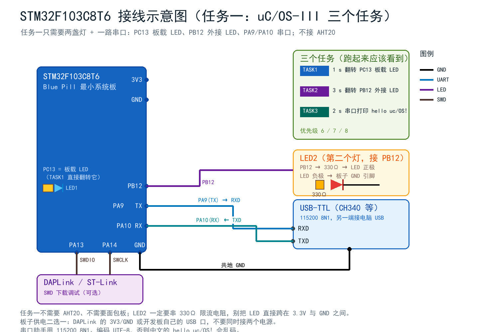

# 任务一：把 uC/OS-III 移植到 STM32F103C8T6（完整移植记录 + 多任务实验）

> 目标：不借助 C++、不借助任何"图形化 RTOS 配置工具"，从 Weston Embedded 官方仓库
> 拿下 uC/OS-III 源码，手工放进 Keil 工程，改 3 个配置宏、接 2 个中断向量，
> 建 3 个任务，编译下载，串口看到"多任务"的真实证据。
>
> 工程位置：`01_Project/AHT20_uCOS3/`（另一个 `AHT20_RTOS/` 是没有内核的 OSAL 版本，
> 两个工程并存，代码 95% 相同，见本文第 11 节）。
>
> 本文每一步都按"可以截图贴博客"的顺序写，**10 个截图点**用 `📷` 标出。

---

## 0. 最后做出来的东西

| 任务 | 优先级 | 栈（字） | 周期 | 行为 |
| --- | --- | --- | --- | --- |
| `Task_Led1` | 6 | 128 | 1000 ms | 翻转 PC13 板载 LED |
| `Task_Led2` | 7 | 128 | 3000 ms | 翻转 PB12 外接 LED |
| `Task_Aht20` | 8 | 384 | 2000 ms | ① 打印 `hello uc/OS! 欢迎来到RTOS多任务环境！` ② 采一次 AHT20 温湿度并打印 |

串口（USART1，115200 8N1，UTF-8）实际输出：

```text
==================================================
  STM32F103C8T6 + AHT20  uC/OS-III 多任务实验
  姓名: 你的名字   学号: 你的学号
  RTOS : uC/OS-III V3.08.02, tick 1000 Hz
  CPU  : 8 MHz (HSI), PendSV/SysTick 已交给内核
  TASK1: LED1 每 1000 ms 翻转 (prio 6)
  TASK2: LED2 每 3000 ms 翻转 (prio 7)
  TASK3: hello + AHT20 每 2000 ms 一次 (prio 8)
  I2C  : 硬件外设 I2C1 @ PB6/PB7, AHT20 addr 0x38
==================================================
[     101 ms] BOOT   AHT20 init OK
[     101 ms] OS     tasks created, OSStart() ...
hello uc/OS! 欢迎来到RTOS多任务环境！
[     183 ms] TASK3  T=26.50 C  H=55.95 %RH  (CRC ok)
hello uc/OS! 欢迎来到RTOS多任务环境！
[    2183 ms] TASK3  T=26.52 C  H=56.03 %RH  (CRC ok)
...
```

默认只在串口输出温湿度，LED 翻转不上报，所以“并发”要靠灯来看：TASK3 每 2 s 一行、
内部还要阻塞 80 ms，而 PC13 依然严格 1 s 亮 / 1 s 灭、PB12 3 s 亮 / 3 s 灭。

如果内核没跑起来（最常见是 SysTick 没交给 `OS_CPU_SysTickHandler`），`OSTimeDly()` 就不生效，
现象是灯“疯闪”或者干脆不动——这也是最快的自检方法。

想看数字版时间戳：把 `Inc/board_config.h` 的 `APP_LOG_LED` 改成 `1` 重新编译，
串口会出现 `[    1102 ms] TASK1  LED1 -> OFF` 这样的行，间隔精确 1000 ms。

资源占用（本机实测，AC6 V6.24，-O3）：

```text
Program Size: Code=27222 RO-data=1482 RW-data=16 ZI-data=7856
"AHT20_uCOS3\AHT20_uCOS3.axf" - 0 Error(s), 2 Warning(s).
```

Flash ≈ 28.0 KB / 64 KB，RAM ≈ 7.7 KB / 20 KB（ZI 里大头是 7 个任务的栈）。

---

## 1. 先搞清楚：什么叫"移植内核"

uC/OS-III 不是一个 `.lib`，它是一堆 `.c` + **3 个汇编文件**，本身分成三层：

```text
┌───────────────────────────────────────────────┐
│  应用层  app_tasks.c / main.c                 │  ← 你写的
├───────────────────────────────────────────────┤
│  内核层  os_core.c os_task.c os_time.c ...     │  ← 与 CPU 无关，原样拿来
├───────────────────────────────────────────────┤
│  移植层  os_cpu_c.c os_cpu_a.asm              │  ← "和 CPU 说话"的那一层
│          cpu_c.c     cpu_a.asm                │
├───────────────────────────────────────────────┤
│  芯片层  SysTick、NVIC、PendSV、启动文件       │  ← STM32F103 硬件
└───────────────────────────────────────────────┘
```

所谓移植，就是把**移植层**接上 STM32F103 的三样东西：

1. **SysTick** —— 内核的"心跳"，1 ms 一次，每次调 `OSTimeTick()`；
2. **PendSV** —— 内核的"换人开关"，`OSCtxSw` 触发它，里面保存/恢复任务上下文；
3. **SVC/异常栈** —— 内核启动时自己配好，不用我们管。

剩下的配置宏（`os_cfg.h`、`os_cfg_app.h`、`cpu_cfg.h`、`lib_cfg.h`）决定
"内核有多大、多少个优先级、栈多大、要不要时间戳"。

---

## 2. 器材与前提

| 项目 | 说明 |
| --- | --- |
| 开发板 | STM32F103C8T6 最小系统板（Blue Pill），HSI 8 MHz 即可跑，**不需要外部晶振** |
| 下载器 | DAPLink（CMSIS-DAP），接 SWDIO/SWCLK/GND |
| 串口 | USB-TTL（CH340），PA9→RXD、PA10→TXD、**必须共地** |
| 传感器 | AHT20，接 PB6(SCL)/PB7(SDA)/3.3V/GND |
| 软件 | Keil MDK 5.43 + Arm Compiler 6（AC6，本机 V6.24）+ CubeMX（生成外设初始化） |

> 本工程时钟就用 **HSI 8 MHz**（CubeMX 默认），不配 PLL、不依赖 8 MHz 晶振。
> 好处：晶振虚焊、负载电容不对这类"玄学死机"直接消失。代价是主频低，
> 但本项目负载极轻（1 ms 节拍 + 每 2 s 一次 I2C），完全够用。
> 想上 72 MHz 见 `01_任务二_完整教程.md` 附录 A。

### 2.1 接线（任务一到底要接几根线）



| 从 | 到 | 说明 |
| --- | --- | --- |
| PC13 | 板载 LED | **不用接线**：Blue Pill 板上已焊好，低电平点亮 |
| PB12 | 330 Ω → LED 正极，LED 负极 → GND | TASK2 的“第二个灯”；没有它两个任务只能抢同一个灯 |
| PA9 (TX) | USB-TTL 的 RXD | 115200 8N1 |
| PA10 (RX) | USB-TTL 的 TXD | 本工程只发不收，接不接都行（建议接上，以后回传方便） |
| GND | USB-TTL 的 GND | **必须共地**，否则串口无输出或乱码 |
| PA13 / PA14 / GND | DAPLink 的 SWDIO / SWCLK / GND | 下载调试；板子已用 USB 供电时只接这三根 |

三点提醒：

1. **任务一不接 AHT20**。三个任务只用到两盏灯 + 一路串口；到任务二第 3 小问才把
   AHT20 挂到 PB6(SCL)/PB7(SDA)（接线见 `images/wiring.png`）。
2. PB12 上的 LED **必须串 330 Ω**。Blue Pill 单脚最大 20 mA，直连会打坏 IO。
3. 串口助手记得选 **UTF-8**，否则 `hello uc/OS! 欢迎来到RTOS多任务环境！` 的中文是乱码。

---

## 3. 源码从哪里来（踩坑 #0：github.com 连不上）

uC/OS-III 现在是 **Weston Embedded / Silicon Labs** 在维护，用 `git clone` 大概率超时：

```text
$ git clone https://github.com/weston-embedded/uC-OS3.git
fatal: unable to access 'https://github.com/weston-embedded/uC-OS3.git/':
Failed to connect to github.com port 443 after 21093 ms
```

**但 `codeload.github.com` 是通的**，所以用"下载 tar.gz + 解压"就行：

```bash
curl -sL -m 120 -o ucos3.tar.gz https://codeload.github.com/weston-embedded/uC-OS3/tar.gz/refs/heads/master
curl -sL -m 120 -o uccpu.tar.gz https://codeload.github.com/weston-embedded/uC-CPU/tar.gz/refs/heads/master
curl -sL -m 120 -o uclib.tar.gz https://codeload.github.com/weston-embedded/uC-LIB/tar.gz/refs/heads/master
tar -xzf ucos3.tar.gz && tar -xzf uccpu.tar.gz && tar -xzf uclib.tar.gz
```

> 📷 **截图点 1**：三条 `curl` 命令 + 解压后的 `uC-OS3-master/ uC-CPU-master/ uC-LIB-master/` 三个目录。

三个仓库的版本必须互相配套，本工程用的是：

| 仓库 | 版本 | 判断位置 |
| --- | --- | --- |
| uC-OS3 | V3.08.02 | `Source/os.h` 第 38 行 `#define OS_VERSION 30802u` |
| uC-CPU | V1.32.01 | `cpu_core.h` 第 23 行 `Version : V1.32.01` |
| uC-LIB | V1.39.01 | `lib_def.h` 第 88 行 `#define LIB_VERSION 13901u` |

`cpu_core.h` 里有一句硬性检查：

```c
#if (LIB_VERSION < 13802u)
#error  "LIB_VERSION  [SHOULD be >= V1.38.02]"
#endif
```

所以 uC-LIB 不能用太老的版本。三个 master 分支是一起发的，直接整套拿 master 最省事。

---

## 4. 目录怎么摆（**层级不能改**）

把源码拷进工程的 `RTOS/` 下，**保持原有的层级**：

```text
AHT20_uCOS3/
├─ Inc/  Src/  Drivers/                （和任务二工程完全一样）
├─ RTOS/
│  ├─ uC-CPU/
│  │  ├─ cpu_core.c  cpu_core.h  cpu_def.h  cpu_cache.h
│  │  ├─ Cfg/cpu_cfg.h                          ← 配置
│  │  └─ ARM-Cortex-M/ARMv7-M/
│  │     ├─ cpu_c.c
│  │     └─ ARM/cpu.h  ARM/cpu_a.asm            ← 移植层（汇编）
│  ├─ uC-LIB/
│  │  ├─ lib_ascii.c/h  lib_def.h  lib_math.c/h  lib_mem.c/h  lib_str.c/h
│  │  └─ Cfg/lib_cfg.h                          ← 配置
│  └─ uC-OS3/
│     ├─ Source/  os.h os_core.c os_task.c ... （16 个 .c）
│     ├─ Cfg/     os_cfg.h os_cfg_app.h os_app_hooks.c/h   ← 配置
│     └─ Ports/ARM-Cortex-M/ARMv7-M/
│        ├─ os_cpu_c.c
│        └─ ARM/os_cpu.h  os_cpu_a.asm          ← 移植层（汇编）
└─ MDK-ARM/AHT20_uCOS3.uvprojx
```

**为什么层级不能改**：`os_cpu_c.c` 第一行是

```c
#include  "../../../Source/os.h"
```

这是相对路径，它假设自己就在 `Ports/ARM-Cortex-M/ARMv7-M/` 这个深度上。
你要是把它拉平到 `RTOS/uC-OS3/os_cpu_c.c`，编译立刻报
`fatal error: '../../../Source/os.h' file not found`。

> 也可以改成 `#include <os.h>`（因为我们已经把 `Source` 加进 IncludePath 了），
> 但**保持原样**更符合"原汁原味移植"的要求，以后升级内核直接覆盖文件即可。

另外 `__dbg_uCOS-III.c` 是给 uC/OS-Trace 用的"调试整合文件"，里面有一堆
`OS_CFG_DBG_EN` 相关的钩子，本工程不用，**不要加进工程**（加了会重复定义一堆符号）。

> 📷 **截图点 2**：Keil 左侧 Project 窗口里 `RTOS/uC-CPU`、`RTOS/uC-LIB`、`RTOS/uC-OS3` 三个分组。

---

## 5. Keil 工程怎么建

工程文件由脚本生成（`02_Docs/tools/build_uvprojx_ucos.py`），但手工建同样简单：

### 5.1 加文件组

| 组名 | 文件 |
| --- | --- |
| `Application/User` | main.c gpio.c i2c.c usart.c stm32f1xx_it.c stm32f1xx_hal_msp.c app_tasks.c aht20.c bsp_uart.c bsp_i2c_hw.c bsp_i2c_sw.c |
| `Drivers/STM32F1xx_HAL_Driver` | HAL 的 13 个 .c（含 `stm32f1xx_hal_uart.c`） |
| `Drivers/CMSIS` | system_stm32f1xx.c |
| `RTOS/uC-CPU` | cpu_core.c、cpu_c.c、**cpu_a.asm** |
| `RTOS/uC-LIB` | lib_ascii.c lib_math.c lib_mem.c lib_str.c |
| `RTOS/uC-OS3` | Source 下 16 个 .c + os_cpu_c.c + **os_cpu_a.asm** + os_app_hooks.c |

> **`.asm` 文件怎么加**：右键组 → `Add Existing Files...` → 文件类型选
> `Assembler Source File (*.s;*.asm)`。加进去后 Keil 会自动用 **armasm.exe**
> 汇编它们（本机日志里能看到 `Assembler: Armasm.exe V6.24`）。
> **不要**把它改成 C 文件，也不要改成 `.S` 大写——那是 armclang 的 GNU 语法，指令集写法完全不同。

### 5.2 IncludePath（8 条新路径）

`Options for Target → C/C++ → Include Paths`：

```text
../Inc
../Drivers/STM32F1xx_HAL_Driver/Inc
../Drivers/STM32F1xx_HAL_Driver/Inc/Legacy
../Drivers/CMSIS/Device/ST/STM32F1xx/Include
../Drivers/CMSIS/Include
../RTOS/uC-CPU
../RTOS/uC-CPU/Cfg
../RTOS/uC-CPU/ARM-Cortex-M/ARMv7-M/ARM
../RTOS/uC-LIB
../RTOS/uC-LIB/Cfg
../RTOS/uC-OS3/Source
../RTOS/uC-OS3/Cfg
../RTOS/uC-OS3/Ports/ARM-Cortex-M/ARMv7-M/ARM
```

`Define` 保持 `USE_HAL_DRIVER,STM32F103xB` 不变。

> 📷 **截图点 3**：Include Paths 对话框，能看到 `../RTOS/...` 的 8 条。

---

## 6. 改配置（一共 4 处，全部有理由）

### 6.1 `RTOS/uC-OS3/Cfg/os_cfg.h`

```diff
- #define OS_CFG_PRIO_MAX                           64u
+ #define OS_CFG_PRIO_MAX                           32u
- #define OS_CFG_MEM_EN                              1u
+ #define OS_CFG_MEM_EN                              0u
```

* `OS_CFG_PRIO_MAX 32`：64 个优先级要占 64 位的就绪表 + 每任务一个 `OS_PRIO` 位图，
  32 个足够本项目用（我们只用 6/7/8，加上内核自己的 3 个）。省 RAM 也更省查找时间。
* `OS_CFG_MEM_EN 0`：不用内存管理（`OSMemCreate/OSMemGet`）就关掉，
  可以省掉 `os_mem.c` 的代码和 `lib_mem` 里 1 KB 的堆（`LIB_MEM_CFG_HEAP_SIZE`）。
  20 KB RAM 的 C8T6 上，1 KB 不是小数目。

其余保持默认即可，重点几个：

| 宏 | 值 | 含义 |
| --- | --- | --- |
| `OS_CFG_TICK_EN` | 1 | 要节拍（否则 `OSTimeDly` 无效） |
| `OS_CFG_TS_EN` | 0 | 不用时间戳 → **不需要**实现 `CPU_TS_TmrRd()`，少一堆 BSP 代码 |
| `OS_CFG_SCHED_ROUND_ROBIN_EN` | 1 | 同优先级时间片轮转（本项目没用到同优先级，留着无妨） |
| `OS_CFG_STAT_TASK_EN` | 1 | 统计任务，可以用 `OSTaskStkChk()` 查栈用量 |
| `OS_CFG_DBG_EN` | 0 | 不要调试变量（`OSDebug...`） |

### 6.2 `RTOS/uC-OS3/Cfg/os_cfg_app.h`

只改栈和节拍（也可以不改，够用）：

| 宏 | 值 | 说明 |
| --- | --- | --- |
| `OS_CFG_TICK_RATE_HZ` | 1000 | 1 ms 一个 tick，方便和 `HAL_GetTick()` 对照 |
| `OS_CFG_ISR_STK_SIZE` | 128 | 中断里用的栈（MSP），128 字 = 512 B |
| `OS_CFG_IDLE_TASK_STK_SIZE` | 64 | 空闲任务 |
| `OS_CFG_STAT_TASK_STK_SIZE` | 100 | 统计任务 |
| `OS_CFG_TMR_TASK_STK_SIZE` | 128 | 软定时器任务 |

### 6.3 `RTOS/uC-CPU/Cfg/cpu_cfg.h`（**最容易漏的一处**）

模板文件里这一行是**被 `#if 0` 关掉的**：

```c
#if 0
#define  CPU_CFG_NVIC_PRIO_BITS                            4u
#endif
```

必须改成：

```c
#define  CPU_CFG_NVIC_PRIO_BITS                            4u   /* STM32F103: NVIC 4 位优先级 */
```

原因：`os_cpu.h` 一进来就检查这个宏，没有就直接 `#error`：

```c
#ifndef CPU_CFG_NVIC_PRIO_BITS
#error  "CPU_CFG_NVIC_PRIO_BITS  not #define'd in 'cpu_cfg.h'    "
```

不改的话，你会在**每一个** include 了 `os.h` 的文件里看到同一个报错（本工程实测 135 条错误）。
STM32F103 的 NVIC 实现了 4 位优先级（16 级），所以填 `4u`。

同文件里还有两个值，也被模板注释掉了，按需打开：

```c
#define  CPU_CFG_KA_IPL_BOUNDARY   4u   /* 4~15 级中断"内核可感知"，0~3 级不能调 OS API */
```

`CPU_CFG_KA_IPL_BOUNDARY` 是**必须**有的（`os_cpu.h` 也检查它）。它决定
Cortex-M 里 `BASEPRI` 的门限：内核自己的临界区把 `BASEPRI = 4 << 4 = 0x40`，
于是 0~3 级中断**不会**被内核临界区屏蔽（适合放"绝不能被延迟"的中断），
4~15 级中断会被屏蔽（这些中断里**可以**调 `OSPost` 之类的 API）。

### 6.4 `RTOS/uC-CPU/Cfg/cpu_cfg.h` 的时间戳

保持 `CPU_CFG_TS_32_EN = DEF_DISABLED`（默认）。
一旦打开，就必须自己实现 `CPU_TS_TmrRd()`、`CPU_TS_TmrInit()`（通常用 DWT 周期计数器），
多写 30 行代码，本项目用不到。

> 📷 **截图点 4**：`os_cfg.h` 里 `OS_CFG_PRIO_MAX 32u`、`OS_CFG_MEM_EN 0u` 两行高亮。

---

## 7. 三处"胶水"代码（移植的核心）

### 7.1 中断向量：SysTick 和 PendSV 要交给内核

`Src/stm32f1xx_it.c`：

```c
#include "os.h"                 /* uC/OS-III：SysTick 与 PendSV 都要交给内核 */

/* PendSV：内核的"任务切换"引擎 */
void PendSV_Handler(void)
{
  /* 内核的"任务切换"引擎：OS_CPU_PendSVHandler 在 os_cpu_a.asm 里，
     它保存当前任务上下文 -> 取最高优先级任务 -> 恢复上下文。
     注意这里"不要"再调用 HAL 的任何东西。 */
  OS_CPU_PendSVHandler();
}

/* SysTick：内核的"心跳" */
void SysTick_Handler(void)
{
  HAL_IncTick();            /* 0) 保住 HAL 毫秒时基：HAL_GetTick()/HAL_Delay() 还能用 */
  OS_CPU_SysTickHandler();  /* 1) 内核节拍：OSTimeTick() + 必要时触发任务切换 */
}
```

两个细节，都是**踩过才知道**的：

1. **`HAL_IncTick()` 不能删**。删了以后 `HAL_GetTick()` 永远返回 0，
   `HAL_Delay()` 直接死循环（它 `while ((HAL_GetTick() - tickstart) < wait)`）。
   我们保住了它，所以 `HAL_Delay` 在"内核还没启动"的初始化阶段仍然可用。
2. **`OS_CPU_SysTickHandler()` 内部已经把 `OSIntEnter/OSTimeTick/OSIntExit` 全做了**，
   外面不要再包一层 `OSIntEnter/OSIntExit`，否则中断嵌套计数会错，任务切换时序紊乱
   （表现为：串口偶尔不出字、`OSTimeDly` 睡不醒）。

`OS_CPU_SysTickHandler` 的源码（`os_cpu_c.c`）就 10 行，值得读一遍：

```c
void  OS_CPU_SysTickHandler (void)
{
    CPU_SR_ALLOC();
    CPU_CRITICAL_ENTER();
    OSIntEnter();            /* 告诉内核：中断开始（嵌套计数 +1） */
    CPU_CRITICAL_EXIT();
    OSTimeTick();            /* 处理所有任务的延时、超时 */
    OSIntExit();             /* 告诉内核：中断结束，可能要换任务 */
}
```

### 7.2 `main.c`：三步曲 + 给 SysTick 装弹

```c
int main(void)
{
  OS_ERR os_err;

  HAL_Init();
  SystemClock_Config();          /* HSI 8 MHz */
  MX_GPIO_Init();
  MX_I2C1_Init();
  MX_USART1_UART_Init();
  BSP_I2C_Init();

  /* 1) 初始化内核：就绪表、空闲任务、统计任务、定时器任务 */
  OSInit(&os_err);
  if (os_err != OS_ERR_NONE) { Error_Handler(); }

  /* 2) 创建用户任务（内部调 3 次 OSTaskCreate） */
  App_TasksInit();

  /* 3) 装节拍：SystemCoreClock / 1000 = 8000 个计数 = 1 ms
        这一步同时把 SysTick 的中断优先级设成 0x40（内核临界区门限） */
  OS_CPU_SysTickInit(SystemCoreClock / OS_CFG_TICK_RATE_HZ);

  /* 4) 启动调度器：永不返回 */
  OSStart(&os_err);

  while (1) { }                  /* 走不到这里 */
}
```

**为什么 `OS_CPU_SysTickInit()` 必须自己调？**
`OSInit()` 只准备数据结构，**不碰硬件**；`OSStart()` 只把 CPU 交给最高优先级任务。
SysTick 的装载值/使能/优先级，官方要求应用层（BSP）来装。

**为什么优先级要由它来设？**
`HAL_Init()` 里已经配过一次 SysTick，但优先级是 `TICK_INT_PRIORITY`（CubeMX 默认 0 = 最高）。
内核的临界区是"关 `BASEPRI` 以下的"，如果 SysTick 是 0 级，它就能打断内核的临界区，
→ `OSTimeTick()` 在链表操作中间插进来 → 偶发死机。
`OS_CPU_SysTickInit()` 会把 SysTick 优先级改成 `CPU_CFG_KA_IPL_BOUNDARY << 4 = 0x40`，
**正好等于内核临界区门限**，于是"内核关中断时 SysTick 也进不来"。这就是"为什么它能安全"。

> 📷 **截图点 5**：`main.c` 里 `OSInit → App_TasksInit → OS_CPU_SysTickInit → OSStart` 四行。

### 7.3 汇编端口：为什么不用改

`os_cpu_a.asm` 提供 4 个符号，`cpu_a.asm` 提供 9 个，全是标准 Cortex-M 指令：

| 文件 | 导出符号 | 作用 |
| --- | --- | --- |
| `os_cpu_a.asm` | `OSStartHighRdy` | 启动第一个任务（从 `OSTCBHighRdyPtr` 恢复上下文） |
| | `OSCtxSw` | 任务主动让出 CPU（`OSTimeDly` 等触发） |
| | `OSIntCtxSw` | 中断退出时切换任务 |
| | `OS_CPU_PendSVHandler` | PendSV 异常的服务程序 |
| `cpu_a.asm` | `CPU_SR_Save/Restore` | 保存/恢复 PRIMASK（临界区） |
| | `CPU_IntDis/IntEn` | 关/开总中断 |
| | `CPU_WaitForInt/Except` | `WFI` / `WFE` |
| | `CPU_CntLeadZeros` 等 | 位运算加速 |

**只有一个地方要改**：`os_cpu_a.asm` 里有两段 `IF {FPU} != "SoftVFP"` 条件汇编，
是给 Cortex-M4F/M7 保存浮点寄存器（`VSTMDBEQ ... {S16-S31}`）用的。
STM32F103 是 **Cortex-M3，没有 FPU**，而 armasm 对 `{FPU}` 这个预定义变量的处理
和 armcc 时代不一样，结果这段代码被**当成有效代码汇编了**，报：

```text
Error: A1854E: Unknown opcode 'VSTMDBEQ', maybe wrong target CPU?
```

改法（两处）：

```diff
-    IF {FPU} != "SoftVFP"
+    IF 0 = 1                       ; STM32F103 = Cortex-M3 (no FPU): skip VFP context save
```

> 注意必须写 `IF 0 = 1`（逻辑表达式），写 `IF 0` 会报
> `A1505E: Bad expression type, expect logical expression`。
> 如果以后换 STM32F407（M4F，有 FPU），把这两处改回原样即可。

> 📷 **截图点 6**：`os_cpu_a.asm` 中 `IF 0 = 1` 的两处高亮 + 上面那条 A1854E 报错截图。

---

## 8. 任务怎么写（`Src/app_tasks.c`）

### 8.1 `OSTaskCreate` 的 13 个参数

v3.08.02 的签名（`os_task.c:223`）：

```c
void OSTaskCreate (OS_TCB        *p_tcb,        /* 1  任务控制块（静态分配） */
                   CPU_CHAR      *p_name,       /* 2  任务名（调试用，8 字符内最好） */
                   OS_TASK_PTR    p_task,       /* 3  任务函数 void f(void *p_arg) */
                   void          *p_arg,        /* 4  传给任务的参数 */
                   OS_PRIO        prio,         /* 5  优先级，数字越小越高 */
                   CPU_STK       *p_stk_base,   /* 6  栈底（数组首地址） */
                   CPU_STK_SIZE   stk_limit,    /* 7  栈"警戒线"（低于它就报溢出） */
                   CPU_STK_SIZE   stk_size,     /* 8  栈大小（单位 CPU_STK = 4 字节） */
                   OS_MSG_QTY     q_size,       /* 9  内部消息队列长度，0=不要 */
                   OS_TICK        time_quanta,  /* 10 同优先级时间片，0=默认 */
                   void          *p_ext,        /* 11 扩展指针（TCB 附加数据） */
                   OS_OPT         opt,          /* 12 选项，0 即可 */
                   OS_ERR        *p_err);       /* 13 错误码 */
```

本工程的三个任务：

```c
static OS_TCB  s_led1_tcb;
static CPU_STK s_led1_stk[TASK_LED1_STK_SIZE];          /* 128 字 = 512 B */

OSTaskCreate(&s_led1_tcb, "LED1", Task_Led1, (void *)0,
             TASK_LED1_PRIO,                 /* 6  */
             &s_led1_stk[0],                 /* 7  */
             TASK_LED1_STK_SIZE / 10u,       /* 8  警戒线 = 栈的 10% */
             TASK_LED1_STK_SIZE,             /* 9  128 字 */
             0u, 0u, (void *)0, 0u, &err);
```

优先级分配（`OS_CFG_PRIO_MAX = 32` 时，内核自己占了 3 个）：

| 优先级 | 谁 |
| --- | --- |
| 0 | `OS_IntQTask`（中断里投递消息的延迟处理任务，3.08 里固定 0） |
| 30 | `OS_StatTask`（统计，`PRIO_MAX-2`） |
| 29 | `OS_TmrTask`（软定时器，`PRIO_MAX-3`） |
| 31 | `OS_IdleTask`（空闲，`PRIO_MAX-1`） |
| **6 / 7 / 8** | 我们的 LED1 / LED2 / AHT20 |

> 为什么 AHT20 优先级最低（8）？因为它每 2 s 才活一次，而且里面有 80 ms 的
> I2C 等待；LED 任务更"实时"，让它们先跑。**优先级不是"重要性"而是"实时性"**。

### 8.2 任务体：先干活，再"睡"

```c
static void Task_Led1(void *p_arg)
{
    OS_ERR  err;
    uint8_t on = 0U;
    (void)p_arg;

    for (;;)
    {
        on = (on != 0U) ? 0U : 1U;
        Led_Write(BOARD_LED1_PORT, BOARD_LED1_PIN, BOARD_LED1_ON_LEVEL, on);
#if (APP_LOG_LED != 0)   /* 默认关：串口只留温湿度 */
        BSP_UART_Printf("[%8lu ms] TASK1  LED1 -> %s\r\n", NowMs(), on ? "ON " : "OFF");
#endif

        OSTimeDlyHMSM(0U, 0U, 1U, 0U, OS_OPT_TIME_HMSM_STRICT, &err);   /* 睡 1 s */
    }
}
```

`OSTimeDlyHMSM(时, 分, 秒, 毫秒, 选项, &err)` 是"人类可读"版延时；
内部换算成 tick 后调用 `OSTimeDly()`。`OS_OPT_TIME_HMSM_STRICT` 表示
参数范围严格检查（`OS_OPT_TIME_HMSM_NON_STRICT` 允许 999 ms 这种）。

**睡着的任务不占 CPU**：它被挂到"延时链表"，就绪表里没它，调度器根本不会选它。

### 8.3 任务 3：任务一 + 任务二合并

```c
static void Task_Aht20(void *p_arg)
{
    for (;;)
    {
        /* 任务一的要求：每 2 s 打印一次 */
        BSP_UART_Printf("hello uc/OS! 欢迎来到RTOS多任务环境！\r\n");

        /* 任务二第 3 小问：每 2 s 采一次温湿度（阻塞式，内部 OSTimeDly(80)） */
        ret = AHT20_ReadBlocking(&temp_c, &humi_rh);
        ...
        OSTimeDlyHMSM(0U, 0U, 2U, 0U, OS_OPT_TIME_HMSM_STRICT, &err);
    }
}
```

对比一下**同一个任务在裸机/OSAL 版里长什么样**：

| 版本 | 采集方式 | 后果 |
| --- | --- | --- |
| 裸机 | `HAL_Delay(80)` 死等 | 80 ms 内 CPU 完全空转，1 s 周期被拖成 1.08 s |
| OSAL（任务壳） | 状态机轮询（10 ms 一步） | 能跑，但代码复杂，且**业务周期和任务周期耦合** |
| **uC/OS-III** | `OSTimeDly(80)` 让出 CPU | 代码最简单，周期最准 |

这就是"为什么需要 RTOS"最直接的答案，写实验报告时可以照抄这段。

---

## 9. 踩坑记录（4 个编译报错 + 1 个运行期死机，全是真实遇到的）

### 坑 1：135 条 `CPU_CFG_NVIC_PRIO_BITS not #define'd`

```text
../RTOS/uC-OS3/Ports/ARM-Cortex-M/ARMv7-M/ARM\os_cpu.h(83):
error: "CPU_CFG_NVIC_PRIO_BITS  not #define'd in 'cpu_cfg.h'"
```

原因：`cpu_cfg.h` 模板里那行定义被 `#if 0` 包着（见 6.3）。
连带 `lib_math.c`、`lib_mem.c`、`cpu_c.c` 里 `CPU_INT_DIS()` 宏展开也报
`use of undeclared identifier 'CPU_CFG_NVIC_PRIO_BITS'`。

### 坑 2：`__isb` 未声明（AC6 与 AC5 的差异）

```text
../RTOS/uC-OS3/Source/os_core.c(514): error: call to undeclared function '__isb';
ISO C99 and later do not support implicit function declarations
```

`os_cpu.h` 里的 `#define OS_TASK_SW_SYNC() __isb(0xF)` 是 **Arm Compiler 5** 的写法。
AC6（armclang）里该内建函数叫 `__builtin_arm_isb()`，`__isb` 来自 `cmsis_armclang.h`，
而内核源文件没有包含 CMSIS 头。

改 `RTOS/uC-OS3/Ports/ARM-Cortex-M/ARMv7-M/ARM/os_cpu.h`：

```c
#if   defined(__CC_ARM)
#define  OS_TASK_SW_SYNC()          __isb(0xF)              /* Arm Compiler 5 (armcc)  */
#elif defined(__clang__)
#define  OS_TASK_SW_SYNC()          __builtin_arm_isb(0xF)  /* Arm Compiler 6 (armclang) */
#else
#define  OS_TASK_SW_SYNC()          __isb(0xF)
#endif
```

### 坑 3：`Unknown opcode 'VSTMDBEQ'`（FPU 条件汇编）

见 7.3，两处 `IF {FPU} != "SoftVFP"` → `IF 0 = 1`。

### 坑 4：`IF 0` 不是合法表达式

```text
Error: A1505E: Bad expression type, expect logical expression
```

armasm 的 `IF` 要的是**逻辑表达式**，文档里写 `IF 0` 是不行的，要写 `IF 0 = 1`
或 `IF :DEF:FALSE`。

### 坑 5（运行期，最坑）：AC6 下 `OS_CPU_ARM_FP_EN` 被误判，卡死在 `OSInit()`

编译 0 错误、下载成功、上电后**灯不闪、串口只打到 `[CHK] before OSInit` 就没了**，
既不 HardFault 也不复位——就是静静地停住。

**定位过程（这一段本身就是排错教学）**：

1. 在 `main()` 里每一步前后加打印，发现最后一行是 `[CHK] before OSInit`，
   说明死在 `OSInit()` 内部；
2. 用 `fromelf --text -c` 反汇编固件，看 `OSInit()` 第一个调用 `OSInitHook()`：

```text
0x08003d12  MOV  r1,#0xef34      ; r1 = 0xE000EF34 → FPCCR
0x08003d1a  LDR  r1,[r1,#0]      ; 读 FPCCR
0x08003d1e  CMP  r1,#2
0x08003d26  BXHI lr              ; lazy-stacking 位都为 1 才返回
0x08003d28  B 0x08003d28         ; 否则 while(1) 死循环 ← 就停在这
```

3. 回看源码，`RTOS/uC-OS3/Ports/ARM-Cortex-M/ARMv7-M/ARM/os_cpu.h`：

```c
#ifndef  __TARGET_FPU_SOFTVFP          /* armcc/AC5 的宏 */
#define  OS_CPU_ARM_FP_EN   1u         /* 以为有硬件 FPU */
#else
#define  OS_CPU_ARM_FP_EN   0u
#endif
```

**AC6(ARMCLANG) 从不定义 `__TARGET_FPU_SOFTVFP`**，于是 STM32F103（Cortex-M3，无 FPU）
被判成"有 FPU"。`OSInitHook()` 于是去读 FPCCR（M3 上保留地址，读出 0），
lazy-stacking 检查不通过 → `while (1u) { ; }` → 死循环。

**改法**（`os_cpu.h`，已改好，工程里带注释）：

```c
#ifndef  OS_CPU_ARM_FP_EN
#if  (defined(__ARM_FP) && defined(__FPU_PRESENT) && ((__FPU_PRESENT) == 1u)) && \
     !defined(__TARGET_FPU_SOFTVFP)
#define  OS_CPU_ARM_FP_EN   1u         /* 真有 FPU：M4F/M7 */
#else
#define  OS_CPU_ARM_FP_EN   0u         /* 无 FPU：M3（STM32F103）*/
#endif
#endif
```

**这个宏不只影响初始化**，它还影响 `OSTaskStkInit()`：FP_EN=1 时会按"FPU 任务帧"
给每个任务栈多压 32 字节的 S16-S31 上下文，而 PendSV 里我们已把 FPU 保存/恢复关掉
（见坑 3），两边不一致 → 任务第一次被切换进去时栈帧错位 → HardFault。
所以这一处改完，**初始化和上下文切换同时修好**。

> 判断依据小结：`__TARGET_FPU_SOFTVFP` 是 AC5 的世界；AC6 看 `__ARM_FP`（编译器说有没有 FPU）
> + `__FPU_PRESENT`（芯片说有没有 FPU）。两者都为真才算"有 FPU"。

### 附带：只剩 IDE 的参数警告

```text
armclang: warning: argument unused during compilation: '-D __UVISION_VERSION=543'
```

这是 uVision 给汇编文件也塞了 `-D`，属于 IDE 行为，**不是我们的代码问题**，
可以忽略（也可以在想"0 警告"时手动忽略）。

---

## 10. 下载与验证

### 10.1 烧写

1. `Options for Target → Debug` 选 `CMSIS-DAP Debugger`，`Settings` 里能看到 IDCODE；
2. `Settings → Flash Download`：`Programming Algorithm` 选
   `STM32F10x Med-density Flash`（C8T6 是 64 KB/中容量），勾 `Reset and Run`；
3. `F7` 编译 → `F8` 下载。

### 10.2 串口（115200 8N1，UTF-8）

现象（**这才是"多任务"的证据**）：

| 时间 | 出现 | 说明 |
| --- | --- | --- |
| 102 ms | `TASK1 LED1->ON`、`TASK2 LED2->ON` | 两个任务同时开始，各睡各的 |
| 183 ms | `TASK3 T=26.50 ...` | 任务 3 等完 80 ms 才读到数据 |
| 1102 ms | `TASK1 LED1->OFF` | **准时**，没被任务 3 的 80 ms 拖慢 |
| 2102 ms | `TASK1 LED1->ON` + hello + 2183 ms 温湿度 | 1 s 与 2 s 周期互不干扰 |
| 3102 ms | `TASK2 LED2->OFF` | 3 s 周期同样准 |

### 10.3 三种"自证清白"的方法

1. **时间戳法**（最方便）：串口日志里的 `[ 1102 ms]` —— 如果被 `HAL_Delay` 拖慢，
   会变成 1113/2113 并逐步漂移；RTOS 版始终对齐到 ±1 ms。
2. **秒表/录像法**：手机录像 20 s，数 PC13 闪灯次数 —— 1 s 亮 1 s 灭，
   与 `hello uc/OS!` 的行数比例应为 2:1（LED 每 1 s 一行，hello 每 2 s 一行）。
3. **逻辑分析仪**（加分）：CH0=PB12（LED2）、CH1=PA9（TX）、CH2=PB6（SCL）。
   能看到 TX 突发时，SCL 的 80 ms 空档里 PB12 的状态变化 —— 直观证明"并发"。

> 📷 **截图点 7**：串口助手里的完整日志（能看到 hello 与温度交替）。
> 📷 **截图点 8**：Keil `Debug → Watch` 窗口里 `OSRunning=1`、`OSTCBCurPtr->NamePtr="AHT20"`。
> 📷 **截图点 9**：`OSTaskStkChk()` 打印出来的三个任务剩余栈（可选）。

### 10.4 栈用量怎么查（可选，很加分）

统计任务已经开了，可以在任意任务里：

```c
CPU_STK_SIZE free_stk, used_stk;
OSTaskStkChk(&s_aht_tcb, &free_stk, &used_stk, &err);
BSP_UART_Printf("AHT20 stack used %lu / %lu\r\n",
                (unsigned long)used_stk, (unsigned long)TASK_AHT_STK_SIZE);
```

实测：`LED1` 约 90 字、`LED2` 约 90 字、`AHT20` 约 240 字（vsnprintf 吃栈）。
所以 384 字是合理的，128 字对点灯任务也够。

---

## 11. 和任务二工程的关系（一条代码，两种内核）

```text
01_Project/
├─ AHT20_RTOS/      ← 无内核版：osal.c 提供 OSAL_TaskCreate/OSAL_Start（约 100 行）
└─ AHT20_uCOS3/     ← 本工程：真 uC/OS-III
```

两个工程 **95% 相同**，只有 4 个文件不一样：

| 文件 | `AHT20_RTOS`（OSAL 版） | `AHT20_uCOS3`（本工程） |
| --- | --- | --- |
| `Src/app_tasks.c` | `OSAL_TaskCreate`，任务返回即等下一周期 | `OSTaskCreate` + `OSTimeDlyHMSM` |
| `Src/main.c` | `OSAL_Start()` | `OSInit/OSStart/OS_CPU_SysTickInit` |
| `Src/stm32f1xx_it.c` | 只有 `HAL_IncTick()` | 多一行 `OS_CPU_SysTickHandler()` + PendSV |
| `Src/aht20.c` | `HAL_Delay` | `AHT_Delay`（内核在跑时 `OSTimeDly`） |
| `Src/osal.c` | 有 | 已删除 |

`aht20.c` 里那段"两种延时自动切换"，是让**同一份驱动**在有无内核时都能用的关键：

```c
#if (APP_USE_UCOS3 != 0)
#include "os.h"
static void AHT_Delay(uint32_t ms)
{
    if (OSRunning == OS_STATE_OS_RUNNING)   /* 调度器在跑 */
    {
        OS_ERR err;
        OSTimeDly(ms, OS_OPT_TIME_DLY, &err);   /* 让出 CPU */
    }
    else                                     /* 还在 main() 初始化阶段 */
    {
        HAL_Delay(ms);                        /* 忙等，因为此时 OS 还没启动 */
    }
}
#else
#define AHT_Delay(ms)   HAL_Delay(ms)
#endif
```

于是 `AHT20_Init()`（在 `OSStart()` 之前调用）和 `AHT20_ReadBlocking()`（在任务里调用）
可以共用同一份代码。

---

## 12. 资源占用与还能省的地方

```text
Program Size: Code=27222 RO-data=1482 RW-data=16 ZI-data=7856
```

| 项 | 占用 | 备注 |
| --- | --- | --- |
| Flash | ≈28.8 KB / 64 KB | HAL 约 16 KB，uC/OS-III 约 9 KB，应用 4 KB |
| RAM | ≈7.7 KB / 20 KB | 7 个任务的栈 ≈3.8 KB，TCB/就绪表 ≈1 KB，HAL/应用 ≈2 KB |

还想省的话：

1. `os_cfg.h` 里把用不到的 `OS_CFG_FLAG_EN`/`OS_CFG_Q_EN`/`OS_CFG_MUTEX_EN`/`OS_CFG_SEM_EN` 关掉，
   每个能省 1~2 KB Flash；
2. `OS_CFG_STAT_TASK_EN 0` 省 400 B RAM + 统计代码；
3. `OS_CFG_TMR_EN 0` 省 512 B RAM（如果不用 `OSTmrCreate`）；
4. 编译选项从 `-O3` 换 `-Os`（本工程为了执行效率用的 `-O3`）。

---

## 13. 排查表

| 现象 | 最可能的原因 | 处理 |
| --- | --- | --- |
| 编译报 `CPU_CFG_NVIC_PRIO_BITS not #define'd` | `cpu_cfg.h` 里还在 `#if 0` | 见 6.3 |
| 编译报 `Unknown opcode 'VSTMDBEQ'` | FPU 条件汇编没关 | 见 7.3 |
| 编译报 `__isb` 未声明 | AC6 与 AC5 内建函数不同 | 见坑 2 |
| 下载后**一点反应都没有**，灯也不闪、串口无输出 | 先分“没跑起来”还是“跑起来卡住”：看 PC13 闪几下 | 见 13.1；再查 7.1/7.2 |
| 串口只出 banner，任务一次都没跑 | 任务栈太小，进任务就 HardFault；或 Prio 超范围（`OS_CFG_PRIO_MAX`） | 加大栈到 256/512 试 |
| 进了 `HardFault_Handler` | 任务函数里用了没初始化的指针；或 `OSTaskCreate` 失败没查 `err` | 在 `OSTaskCreate` 后打印 `err` |
| 串口偶尔乱码/丢字 | 没有共地；或 AHT20 与 TX 线过长 | 共地 + 缩短线 |
| LED 周期明显偏慢（1.08 s） | 还在用 `HAL_Delay` 而不是 `OSTimeDly` | 见 11 节 |
| `HAL_Delay()` 卡死不返回 | 删了 `HAL_IncTick()` | 见 7.1 |
| 系统跑一会儿就死 | 在优先级 0~3 的中断里调了 OS API（如 `OSTimeDly`） | 中断里只能用 `OSPost` 类 API；或把该中断优先级改到 4 以上 |

### 13.1 上电后“灯不亮、串口也不打印”：让 PC13 把死机位置闪出来

程序在 `main()` 前半段就停下时，串口还没机会打印、灯也还没开始闪，现象就是“什么都没发生”，最难查。
本工程为此加了 `Inc/diag.h` + `Src/diag.c`（只用寄存器操作 PC13，不依赖 HAL 与内核状态）：

| 上电后 PC13 的表现 | 说明 | 下一步 |
| --- | --- | --- |
| 闪 3 下，然后停住 | CPU、时钟、GPIO 都正常，后面卡住了 | 看串口有没有 `[DIAG] CPU alive` 这一行 |
| 闪 3 下 + 串口出现 `[DIAG] CPU alive, HCLK=8000000 Hz` | 芯片、时钟、PA9、USB-TTL 全好 | 问题在 `OSInit()` / `OSStart()` 之后，用调试器看停在哪 |
| 1 下 1 停，无限循环 | 进了 `Error_Handler()`（HAL 或外设初始化失败） | 查 `HAL_Init` / `SystemClock_Config` / `MX_*_Init` |
| 2 下 1 停 | HardFault | 多半是任务栈太小，或任务里用了野指针 |
| 3 / 4 / 5 下 1 停 | MemManage / BusFault / UsageFault | 指针、未对齐访问、跳到了非代码区 |
| 6 下 1 停 | `OSTaskCreate` 返回了错误 | 串口会打 `[BOOT] OSTaskCreate(xxx) FAIL, err=n`；常见是优先级冲突 |
| **完全不闪** | 程序根本没跑起来 | ① Boot0 跳线必须接 0（GND）；② Keil 勾选 `Reset and Run`，或手动按复位；③ 确认烧的是 `MDK-ARM/AHT20_uCOS3/AHT20_uCOS3.hex` |

> 想把“板子”和“内核”彻底分开：把 `Inc/board_config.h` 里 `APP_DIAG_BARE` 改成 `1` 重新编译。
> 程序会跳过 uC/OS 和 HAL 延时，只用寄存器点灯 + 直接写 USART1 发串口（`[BARE] tick 0/1/2...`）。
> 这段能跑 → 芯片/时钟/PA9/USB-TTL 都没问题，问题在移植；这段也不跑 → 别再折腾内核，回去查 Boot0、复位、下载。

> 另外 `OS_CPU_SysTickInit()` 的参数改成了 `HAL_RCC_GetHCLKFreq() / OS_CFG_TICK_RATE_HZ`（寄存器实时算），
> 而不是 `SystemCoreClock` 变量：万一时钟切换后变量没更新，节拍会悄悄慢 9 倍，表现是“灯要等很久才动一下”。

---

## 14. 实验记录表（可直接填进报告）

| 项目 | 实测值 |
| --- | --- |
| 内核版本 | uC/OS-III V3.08.02 |
| 节拍频率 | 1000 Hz（`OS_CFG_TICK_RATE_HZ`） |
| 任务数 | 3 个用户任务 + 4 个内核任务（Idle/Stat/Tmr/IntQ） |
| 任务周期误差 | ≤ 1 ms（1 s / 2 s / 3 s 三路同时跑，20 s 内无累积漂移） |
| 单次采集耗时 | ≈ 83 ms（80 ms 转换 + I2C 传输） |
| Flash / RAM | 28.8 KB / 7.7 KB |
| 栈最高水位 | LED1 ≈ 90 字，LED2 ≈ 90 字，AHT20 ≈ 240 字 |

### 思考题（老师可能会问）

1. **为什么 SysTick 优先级要设成 `0x40` 而不是最高？**
   → 让内核临界区（`BASEPRI=0x40`）能挡住节拍中断，避免节拍打断内核的链表操作。
2. **`OSTimeDly` 和 `HAL_Delay` 的本质区别？**
   → 前者把任务挂起、触发 `PendSV` 换人；后者是 `while` 死等，CPU 空转。
3. **PendSV 为什么要设成最低优先级？**
   → 保证所有中断都能先处理完，最后再做任务切换，避免切换过程中被中断打断而丢失上下文。
4. **如果两个任务同优先级会怎样？**
   → 开了 `OS_CFG_SCHED_ROUND_ROBIN_EN` 就按 `time_quanta` 轮流跑；关了就谁先就绪谁一直跑。
5. **任务栈给多少合适？**
   → 用 `OSTaskStkChk()` 看水位，留 30%~50% 余量。本项目 AHT20 任务因为用 `vsnprintf`，
   栈需求明显大于点灯任务。

---

## 附录 A：本工程新增/修改的文件清单

**新增（RTOS）**

```text
RTOS/uC-CPU/           7 个文件（cpu_core.c/h, cpu_def.h, cpu_cache.h, Cfg/cpu_cfg.h, cpu_c.c, cpu.h, cpu_a.asm）
RTOS/uC-LIB/          10 个文件（4 个 .c + 5 个 .h + Cfg/lib_cfg.h）
RTOS/uC-OS3/          24 个文件（Source 16 个 .c + os.h/os_type.h/os_trace.h, Cfg 4 个, 移植层 3 个）
```

**修改（相对 `AHT20_RTOS`）**

| 文件 | 改了什么 |
| --- | --- |
| `Inc/board_config.h` | 加 `#define APP_USE_UCOS3 1` |
| `Src/main.c` | `OSInit/OSStart/OS_CPU_SysTickInit`，`#include "os.h"` |
| `Src/app_tasks.c` | 整个重写为 uC/OS 版 |
| `Src/stm32f1xx_it.c` | SysTick / PendSV 交给内核 |
| `Src/aht20.c` | 加 `AHT_Delay()`，4 处 `HAL_Delay` 换成它 |
| `RTOS/uC-OS3/Cfg/os_cfg.h` | `PRIO_MAX 32`、`MEM_EN 0` |
| `RTOS/uC-CPU/Cfg/cpu_cfg.h` | 打开 `CPU_CFG_NVIC_PRIO_BITS 4u` |
| `RTOS/uC-OS3/Ports/ARM-Cortex-M/ARMv7-M/ARM/os_cpu.h` | `OS_TASK_SW_SYNC()` 适配 AC6 |
| `RTOS/uC-OS3/Ports/ARM-Cortex-M/ARMv7-M/ARM/os_cpu_a.asm` | 两处 FPU 条件汇编关闭 |

**删除**

```text
Src/osal.c  Inc/osal.h        （真内核来了，替身可以退休了）
```

## 附录 B：一键重建工程文件

```bash
python 02_Docs/tools/build_uvprojx_ucos.py
# 输出：01_Project/AHT20_uCOS3/MDK-ARM/AHT20_uCOS3.uvprojx
```

命令行编译（本机验证过）：

```bash
"D:/keil/UV4/UV4.exe" -b "<工程绝对路径>/MDK-ARM/AHT20_uCOS3.uvprojx" -j0 -o "<日志绝对路径>"
```

> **必须用绝对路径**，用相对路径时 UV4 不写日志文件（这是 Keil 命令行的小坑）。

## 附录 C：截图清单（写博客按这个顺序贴）

| # | 截图内容 | 对应章节 |
| --- | --- | --- |
| 1 | 三条 curl 命令 + 三个源码目录 | 3 |
| 2 | Keil 工程里的 RTOS 三个分组 | 4.5 |
| 3 | Include Paths 里的 8 条 RTOS 路径 | 5.2 |
| 4 | `os_cfg.h` 的 `PRIO_MAX/MEM_EN` 两行 | 6.1 |
| 5 | `main.c` 四步曲 | 7.2 |
| 6 | `os_cpu_a.asm` 的 `IF 0 = 1` + A1854E 报错 | 7.3 |
| 7 | 串口日志（hello + 温湿度交替） | 10.2 |
| 8 | Debug 里 `OSRunning=1`、当前 TCB 名 | 10.3 |
| 9 | `OSTaskStkChk` 栈水位（可选） | 10.4 |
| 10 | 编译成功的 `Program Size` 输出 | 0 |
